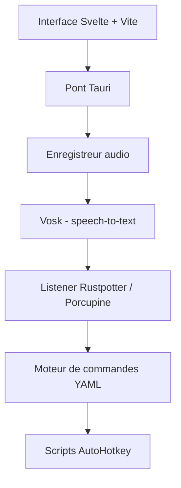

# Priler/jarvis

> Assistant vocal de bureau, hors ligne, en Rust et Tauri, pour exécuter des commandes par la voix.

## Le problème
Les assistants vocaux courants passent par le cloud et collectent des données ; un assistant local, ouvert et sans collecte reste rare.

## Ce que ça fait vraiment
Le backend Rust enregistre l'audio, le convertit en texte avec Vosk, détecte le mot d'éveil (Rustpotter en cours, ou Picovoice Porcupine avec clé d'API) puis lance la commande correspondante. Chaque commande a un fichier YAML et des scripts AutoHotkey (navigateur, volume, Steam, etc.). L'interface est en Svelte via Tauri. Le README signale qu'il est périmé et que la partie NLU et chat n'existe pas encore.

## Comment c'est branché


## Essayer
```bash
cargo tauri dev
cargo tauri build
```
Rust et NodeJS doivent être installés, avec des bibliothèques propres à la plateforme pour PvRecorder et Vosk.

## Coût et pièges
Gratuit. Porcupine exige une clé d'API ; Vosk comme mot d'éveil est « très lent » d'après le README. Les scripts AutoHotkey indiquent un usage orienté Windows. Licence présente mais non identifiée : à vérifier.

## Ce que ce n'est pas
Ce n'est pas un assistant conversationnel : pas de NLU, pas de LLM actif (ChatGPT « bientôt »). Ce n'est pas une version stable : le README dit lui-même être obsolète.

## Alternatives
Aucune alternative nommée dans le README.

## Pour toi
À surveiller : un point de départ intéressant pour de la voix locale (STT, mot d'éveil), mais README périmé, NLU absente et un seul auteur.

