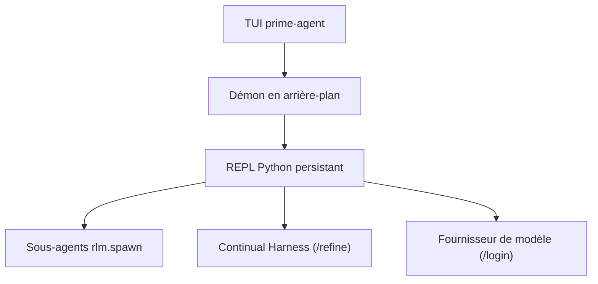

# PrimeIntellect-ai/prime-agent

> Terminal coding and research agent with a persistent Python REPL and recursive sub-agents.

## The problem
Coding agents lose context and state between sessions and struggle with long tasks, notably in research evaluation.

## What it actually does
The model drives a persistent Python REPL: files, shell and sub-agents (`rlm.spawn`) all go through code. A daemon keeps sessions alive after the terminal disconnects. `/refine` updates extra prompts, memories and skills, with snapshots for rollback. Persistent goals, heartbeats, scheduling, bounded autonomous mode.

## How it is wired


## Trying it
```bash
curl -fsSL https://app.primeintellect.ai/prime-agent/install.sh | sh
cd /path/to/project
prime-agent
prime-agent agents
prime-agent doctor [--fix]
```

## Cost and gotchas
Subscription or API key from a provider (`/login`). Installation via `curl | sh`. The README warns: it runs generated Python with your permissions, it is not a sandbox.

## What it is not
Not a security sandbox. `/refine` does not replace reviewing executable skills. Reaching an autonomy threshold does not prove the task succeeded.

## Alternatives
No alternative named in the README.

## For you
Keep an eye on it: useful ideas for long evaluations, but the license is unidentified and execution is not isolated.
