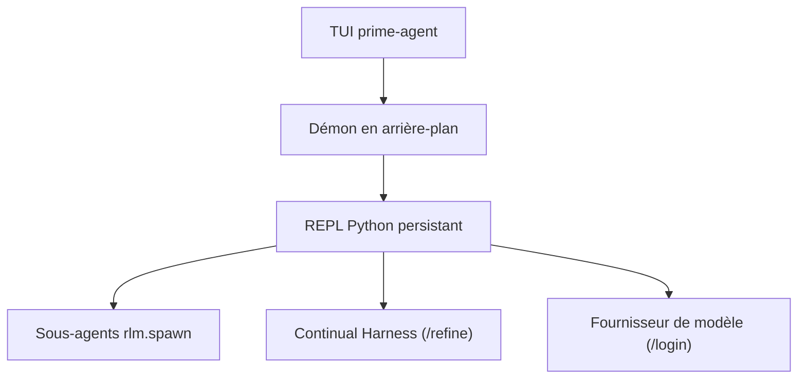

# PrimeIntellect-ai/prime-agent

> Agent de code et de recherche en terminal, à REPL Python persistant et sous-agents récursifs.

## Le problème
Les agents de code perdent contexte et état entre les sessions et peinent sur les tâches longues, notamment en évaluation de recherche.

## Ce que ça fait vraiment
Le modèle pilote un REPL Python persistant : fichiers, shell et sous-agents (`rlm.spawn`) passent par du code. Un démon garde les sessions actives après déconnexion du terminal. `/refine` met à jour prompts supplémentaires, mémoires et skills, avec instantanés pour retour arrière. Objectifs persistants, heartbeats, planification, mode autonome borné.

## Comment c'est branché


## Essayer
```bash
curl -fsSL https://app.primeintellect.ai/prime-agent/install.sh | sh
cd /path/to/project
prime-agent
prime-agent agents
prime-agent doctor [--fix]
```

## Coût et pièges
Abonnement ou clé d'API d'un fournisseur (`/login`). Installation par `curl | sh`. Le README avertit : exécute du Python généré avec tes droits, ce n'est pas un bac à sable.

## Ce que ce n'est pas
Pas un sandbox de sécurité. `/refine` ne remplace pas la revue des skills exécutables. Un seuil d'autonomie atteint ne prouve pas que la tâche est réussie.

## Alternatives
Aucune alternative nommée dans le README.

## Pour toi
Surveiller : idées utiles pour les évaluations longues, mais licence non identifiée et exécution sans isolation.

