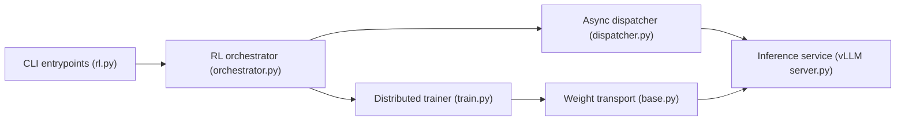

# PrimeIntellect-ai/prime-rl

> Asynchronous RL post-training framework (SFT, RL, evals) for LLMs, from one GPU to more than a thousand.

## The problem
Training models with agentic RL at scale requires orchestrating inference, trajectory generation and distributed training.

## What it actually does
An asynchronous orchestrator distributes generation (vLLM) and collects trajectories and rewards; an FSDP2 trainer applies the algorithms (GRPO, etc.) then republishes the weights via filesystem, NCCL or NIXL transport. TOML configuration. Targets Slurm and Kubernetes; `verifiers` environments. Evals and monitoring (file, W&B, local dashboard) included.

## How it is wired


## Trying it
```bash
curl -sSL https://raw.githubusercontent.com/PrimeIntellect-ai/prime-rl/main/scripts/install.sh | bash
uv sync --all-extras
uv run sft @ configs/debug/fake/sft.toml
uv run inference --vllm.model Qwen/Qwen3-0.6B
uv run rl @ configs/basic/reverse-text/rl.toml
```

## Cost and gotchas
At least one NVIDIA GPU (2 for the full RL stack), Python 3.12; Flash Attention 3 is compiled from source. W&B and HuggingFace optional (tokens). 223 open issues.

## What it is not
Not a lightweight library for one-off fine-tuning: it assumes GPU infrastructure and cluster logic. The announced scales (1000+ GPUs) cannot be verified from the README.

## Alternatives
No alternative named in the README.

## For you
To watch: relevant if you do RL on LLMs with dedicated GPUs, but out of reach of a machine without an NVIDIA GPU.
