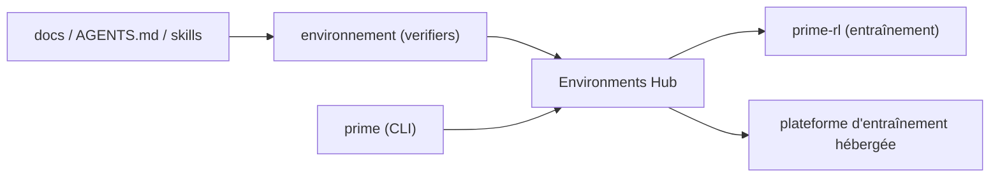

# PrimeIntellect-ai/verifiers

> Library for building environments to train and evaluate language models.

## The problem
Training or evaluating an LLM on a task requires an environment: an interaction loop, a success criterion,
a reward. Without a common framework, every task is rewritten from scratch and cannot be compared.

## What it actually does
The README says only three things: it is Prime Intellect's library for creating LLM training and
evaluation environments; it is tightly integrated with the Environments Hub, the `prime-rl` training
framework and the hosted training platform; and the `prime` CLI is the recommended way to interact with
environments. Everything else is deferred to the documentation, the `AGENTS.md` file and the skills
aimed at coding agents.

## How it is wired


## Trying it
```bash
curl -LsSf https://astral.sh/uv/install.sh | sh
uv tool install prime
```

## Cost and gotchas
Free on the library side. The Environments Hub and the hosted platform are the vendor's services: an
account is required, and the cost of a hosted training run is not documented here.

## What it is not
Not a training framework: `prime-rl` does the training, verifiers only provides the environments.
README under 800 characters: no API, no example, no visible project structure — a minimal sheet,
everything must be checked in the external documentation before investing in it.

## Alternatives
- `prime-rl`: the training part from the same vendor, if the need is optimization.

## For you
Worth keeping in mind for building reusable evaluations; unreadable from this README alone.
