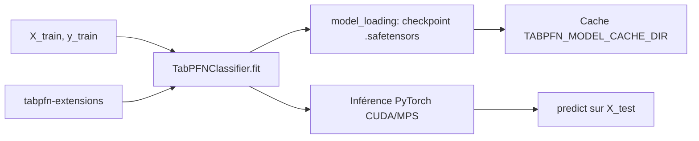

# PriorLabs/TabPFN

> Tabular foundation model that classifies and regresses without training, through a scikit-learn API.

## The problem
On tabular data, every new dataset requires a full cycle: preparation, algorithm choice,
hyperparameter search. Slow, and often ending up back at gradient boosting.

## What it actually does
`TabPFNClassifier` and `TabPFNRegressor` are used like sklearn estimators: `fit` then
`predict`, the checkpoint is downloaded on first call. The default TabPFN-3.5 accepts up to
1,000,000 rows and 20,000 columns; a Fast variant exists, and older versions remain
available through `ModelVersion`. Handles missing values. A fitted estimator can be serialized
with `save_fitted_tabpfn_model`.

## How it is wired


## Trying it
```bash
pip install tabpfn
pip install tabpfn-extensions
python scripts/download_all_models.py
export TABPFN_MODEL_CACHE_DIR="/path/to/models"
export TABPFN_ALLOW_CPU_LARGE_DATASET=true
```

## Cost and gotchas
Python 3.10+. A GPU is strongly recommended: on CPU, capped at 5,000 samples unless an environment variable is set. On first use a browser window opens to **accept the PriorLabs
license**; in CI you must set `TABPFN_TOKEN`. Each `predict` recomputes over the training set — predicting 100 samples one by one costs almost 100 times more.

## What it is not
It is not freely reusable in production: commercial use goes through an Enterprise
Edition and a sales contact. It is not a model that needs preprocessing: scaling and
one-hot encoding are explicitly counterproductive.

## Alternatives
- **TabPFN Client**: hosted inference, if you have no GPU.
- **TabPFN UX**: no-code interface, for exploring before integrating.

## For you
Worth testing seriously on your tabular datasets — but check the license before any client use.
