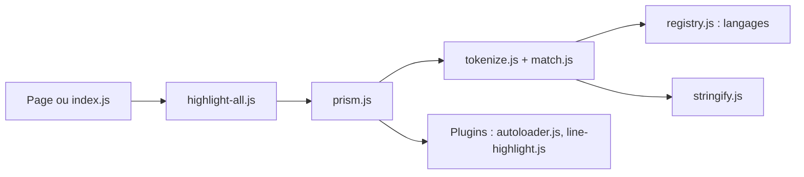

# PrismJS/prism

> Syntax highlighting library for browsers and Node.js, extensible with languages and plugins.

## The problem
Displaying readable, colored code in a web page without writing a tokenizer.

## What it actually does
Takes a text or a `code` element, resolves the language grammar, splits it into tokens and produces colored HTML. Plugins add automatic language loading, line numbers, previews, command line. The README states that a v2 is in the works: only security PRs are accepted.

## How it is wired


## Trying it
```bash
npm ci
npm run build
```
(contribution commands; the README does not detail usage.)

## Cost and gotchas
Free. Do not edit `prism.js`: it is generated from `components/`. Use `npm ci`, not `npm install`.

## What it is not
The README does not document usage, only contribution (usage is on prismjs.com). No semantic analysis of code.

## Alternatives
- prism-themes: to add themes.

## For you
Ignore: useful for a blog or web docs, of no direct interest for data/AI.
