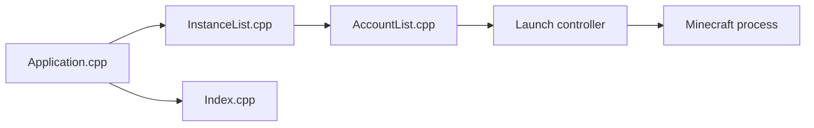

# PrismLauncher/PrismLauncher

> Minecraft launcher to manage several game installations in parallel, aimed at players.

## The problem
Playing several Minecraft versions or modpacks means juggling folders and Java versions.

## What it actually does
Desktop application (C++): instance catalog, account authentication, game environment preparation, launching and log reading. It also handles modpack import via providers, Java management, worlds and themes.

## How it is wired


## Trying it
```bash
# Installation par téléchargement depuis le site ; aucune commande dans le README.
```

## Cost and gotchas
Free. Building from source: Microsoft and CurseForge API keys are included in CMakeLists.txt, with their terms of use; a fork must replace them. A Minecraft/Microsoft account is needed to play.

## What it is not
Not affiliated with Mojang or Microsoft. Development builds are unstable. GPL-3.0 license: copyleft for modified redistributions.

## Alternatives
No alternative named in the README.

## For you
Ignore for your data/AI/MLOps profile: it is a gaming tool unrelated to your job.
