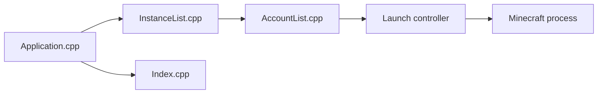

# PrismLauncher/PrismLauncher

> Lanceur Minecraft pour gérer plusieurs installations du jeu en parallèle, destiné aux joueurs.

## Le problème
Jouer à plusieurs versions ou modpacks de Minecraft impose de jongler avec des dossiers et des versions de Java.

## Ce que ça fait vraiment
Application de bureau (C++) : catalogue d'instances, authentification de compte, préparation de l'environnement du jeu, lancement et lecture des journaux. Elle gère aussi l'import de modpacks via des fournisseurs, la gestion de Java, les mondes et les thèmes.

## Comment c'est branché


## Essayer
```bash
# Installation par téléchargement depuis le site ; aucune commande dans le README.
```

## Coût et pièges
Gratuit. Compilation depuis les sources : des clés d'API Microsoft et CurseForge sont incluses dans CMakeLists.txt, avec leurs conditions d'utilisation ; un fork doit les remplacer. Un compte Minecraft/Microsoft est nécessaire pour jouer.

## Ce que ce n'est pas
Pas affilié à Mojang ni Microsoft. Les builds de développement sont instables. Licence GPL-3.0 : copyleft pour les redistributions modifiées.

## Alternatives
Aucune alternative nommée dans le README.

## Pour toi
À ignorer pour ton profil data/IA/MLOps : c'est un outil de jeu sans lien avec ton métier.

