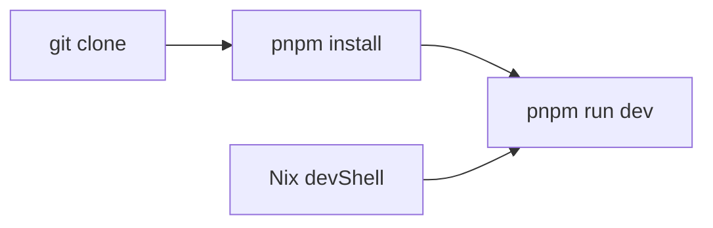

# PrismLauncher/prismlauncher.org

> Source code of the Prism Launcher website; the README is limited to the development environment.

## The problem
Not documented: the README says nothing beyond getting the site started.

## What it actually does
The README only describes the development environment: a Nix devShell (`shell.nix`, flake, `nix-direnv`) or a manual install with pnpm, then a local development server.

## How it is wired
Simplified diagram based on the sheet, no diagram provided.


## Trying it
```bash
git clone https://github.com/PrismLauncher/prismlauncher.org.git
pnpm install
pnpm run dev
```

## Cost and gotchas
Free. pnpm required, Nix optional. The site's framework is not specified.

## What it is not
Not the launcher itself: only its showcase website. Not a reusable tool.

## Alternatives
None named in the README.

## For you
Ignore: website of a game launcher, unrelated to data / AI work.
