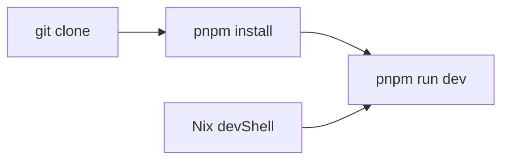

# PrismLauncher/prismlauncher.org

> Code du site web de Prism Launcher ; README limité à l'environnement de développement.

## Le problème
Non documenté : le README ne dit rien de plus que la mise en route du site.

## Ce que ça fait vraiment
Le README décrit seulement l'environnement de développement : un devShell Nix (`shell.nix`, flake, `nix-direnv`) ou une installation manuelle avec pnpm, puis un serveur de développement local.

## Comment c'est branché
Schéma simplifié d'après la fiche, sans diagramme fourni.


## Essayer
```bash
git clone https://github.com/PrismLauncher/prismlauncher.org.git
pnpm install
pnpm run dev
```

## Coût et pièges
Gratuit. pnpm requis, Nix en option. Le framework du site n'est pas précisé.

## Ce que ce n'est pas
Pas le lanceur lui-même : seulement son site vitrine. Pas un outil réutilisable.

## Alternatives
Aucune nommée dans le README.

## Pour toi
Ignorer : site web d'un lanceur de jeu, sans rapport avec un travail data / IA.

