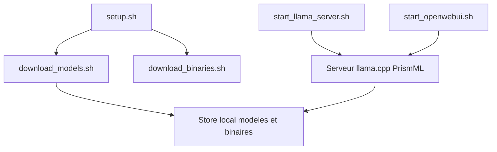

# PrismML-Eng/Bonsai-demo

> Scripts to run the heavily quantized Bonsai 2 models (2B to 27B) locally, with vision and tools.

## The problem
Large models take up too much memory for an ordinary machine; you have to find the right weights, binaries and settings for each platform.

## What it actually does
`setup.sh` downloads the Bonsai 2 weights (27B by default, GGUF or MLX) and the binaries of a llama.cpp fork. Scripts launch a chat server at http://localhost:8080 (chat, vision, tool calls, MCP) or MLX on Apple Silicon. Optional: Open WebUI with demo tools (read-only SQL, weather, web retrieval, code interpreter). 262K-token context.

## How it is wired


## Trying it
```bash
git clone https://github.com/PrismML-Eng/Bonsai-demo.git
cd Bonsai-demo
./setup.sh
./scripts/start_llama_server.sh
```

## Cost and gotchas
The 27B model weighs about 7.8 GB, plus Open WebUI and the interpreter (a few GB). The `PQ2_0` format requires the PrismML fork of llama.cpp. The server listens on 127.0.0.1 by default.

## What it is not
Not an independent benchmark: the "98.2% of FP16 intelligence" is a claim by the authors. The weights are under the model's own license, to be checked.

## Alternatives
- Upstream llama.cpp: accepts the official `Q2_0` format.

## For you
Worth watching if you want to test a quantized LLM locally with vision and tools; check the quality on your own tasks.
