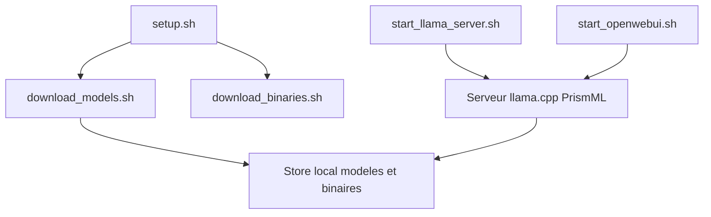

# PrismML-Eng/Bonsai-demo

> Scripts pour lancer en local les modèles Bonsai 2 très quantifiés (2B à 27B) avec vision et outils.

## Le problème
Les gros modèles occupent trop de mémoire pour un poste ordinaire ; il faut trouver les bons poids, binaires et réglages par plateforme.

## Ce que ça fait vraiment
`setup.sh` télécharge les poids Bonsai 2 (27B par défaut, GGUF ou MLX) et les binaires d'un fork de llama.cpp. Des scripts lancent un serveur de chat sur http://localhost:8080 (chat, vision, appels d'outils, MCP) ou MLX sur Apple Silicon. En option : Open WebUI avec outils de démonstration (SQL en lecture seule, météo, récupération web, interpréteur de code). Contexte de 262 K jetons.

## Comment c'est branché


## Essayer
```bash
git clone https://github.com/PrismML-Eng/Bonsai-demo.git
cd Bonsai-demo
./setup.sh
./scripts/start_llama_server.sh
```

## Coût et pièges
Le modèle 27B pèse environ 7,8 Go, plus Open WebUI et l'interpréteur (quelques Go). Le format `PQ2_0` exige le fork PrismML de llama.cpp. Le serveur écoute en 127.0.0.1 par défaut.

## Ce que ce n'est pas
Pas un benchmark indépendant : le « 98,2 % de l'intelligence FP16 » est une affirmation des auteurs. Les poids sont sous licence propre au modèle, à vérifier.

## Alternatives
- llama.cpp amont : accepte le format officiel `Q2_0`.

## Pour toi
À surveiller si tu veux tester un LLM quantifié en local avec vision et outils ; vérifie la qualité sur tes propres tâches.

