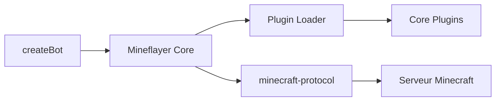

# PrismarineJS/mineflayer

> High-level JavaScript API for building Minecraft bots, also usable from Python.

## The problem
Writing a Minecraft client that speaks the protocol, tracks the world and moves requires a lot of low-level work.

## What it actually does
Tracks entities and blocks, handles physics, inventory, crafting, chests, building, chat. Supports Minecraft 1.8 to 26.1. Plugin system (pathfinder, PVP, viewer…). Built on prismarine modules and minecraft-protocol.

## How it is wired


## Trying it
```bash
npm install mineflayer
npm test
```

## Cost and gotchas
Free; Microsoft auth or offline mode; a Minecraft server is required. 518 open issues.

## What it is not
Not an AI: it is an interface API, to which you must add the logic.

## Alternatives
No alternative named in the README.

## For you
Watch: serves as a sandbox for LLM agents (Voyager, mindcraft, minecraft-mcp-server are cited); useful if you do agentic AI.
