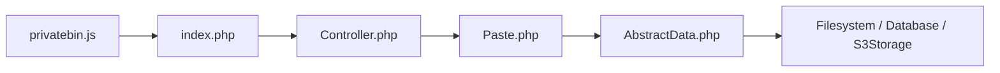

# PrivateBin/PrivateBin

> Self-hosted pastebin where the server knows nothing about the encrypted content, for administrators.

## The problem
Sharing text or code through a public pastebin exposes the content to the server and its operator.

## What it actually does
The browser encrypts the content with AES-256 GCM before sending it; the key stays in the URL fragment after `#`. Options: password, expiration, "burn after reading", discussions, Markdown, syntax highlighting, file upload (disabled by default), several themes. Fork of ZeroBin.

## How it is wired

## Trying it
No command documented in this README, which points to the installation guide.

## Cost and gotchas
Free. HTTPS is mandatory; the administrator can serve malicious code and access logs remain visible. License present but not identified by GitHub.

## What it is not
Not a safeguard against a compromised server: the README says so itself. A public URL without a password is readable by anyone.

## Alternatives
- No alternative named in the README.

## For you
Ignore: useful in a homelab for sharing logs, but unrelated to data/AI, and the license needs checking.
