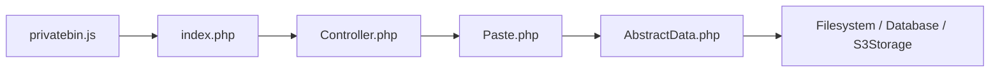

# PrivateBin/PrivateBin

> Pastebin auto-hébergé où le serveur ne connaît rien du contenu chiffré, pour administrateurs.

## Le problème
Partager du texte ou du code via un pastebin public expose le contenu au serveur et à son opérateur.

## Ce que ça fait vraiment
Le navigateur chiffre le contenu en AES-256 GCM avant l'envoi ; la clé reste dans le fragment d'URL après `#`. Options : mot de passe, expiration, « burn after reading », discussions, Markdown, coloration syntaxique, envoi de fichiers (désactivé par défaut), plusieurs thèmes. Fork de ZeroBin.

## Comment c'est branché

## Essayer
Aucune commande documentée dans ce README, qui renvoie au guide d'installation.

## Coût et pièges
Gratuit. HTTPS obligatoire ; l'administrateur peut servir du code malveillant et les journaux d'accès restent visibles. Licence présente mais non identifiée par GitHub.

## Ce que ce n'est pas
Pas une preuve contre un serveur compromis : le README le dit lui-même. Une URL publique sans mot de passe est lisible par tous.

## Alternatives
- Aucune alternative nommée dans le README.

## Pour toi
À ignorer : utile en homelab pour partager des logs, mais sans rapport avec la data/IA, et la licence est à vérifier.

