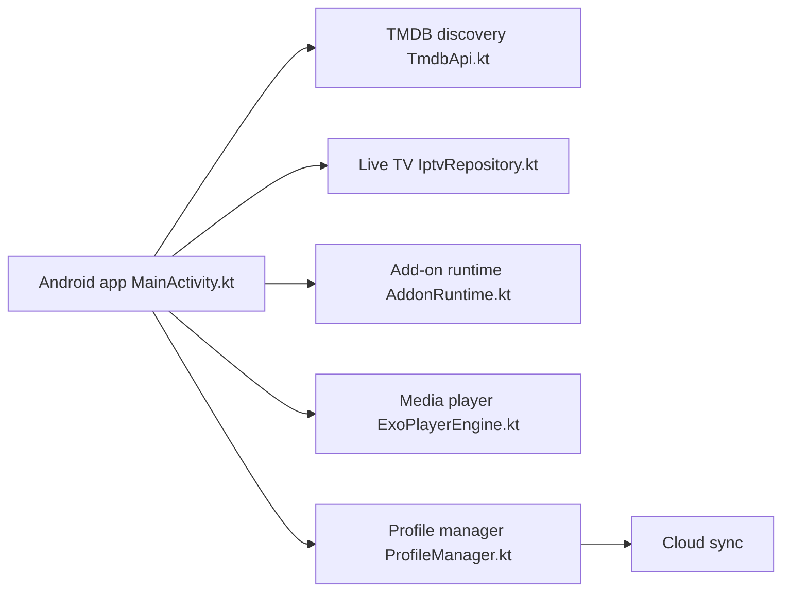

# ARVIO

> Media app for Android TV, mobile and web, aggregating your own sources, servers and watchlists.

## The problem
Catalogs, home servers, live TV, add-ons and tracking are scattered across different applications.

## What it actually does
Provides a home screen, collections, calendar, Plex, Emby and Jellyfin, live TV (M3U, Xtream, Stalker), community add-ons, debrid services, Telegram search, Trakt and SIMKL tracking, subtitles and profiles. Contains no content: you connect your own authorized sources. Web version can be self-hosted.

## How it is wired


## Trying it
```bash
git clone https://github.com/ProdigyV21/ARVIO.git
cd ARVIO
cp secrets.defaults.properties secrets.properties
./gradlew :app:assembleSideloadDebug
```

## Cost and gotchas
The Android app is free; the hosted web version requires ARVIO Premium; self-hosting is free. TMDB, Trakt and SIMKL keys must be supplied. Firebase crash reports in production builds.

## What it is not
Not a content provider: without sources, nothing is playable. Community add-ons and debrid services raise rights questions, which are your responsibility.

## Alternatives
No alternative named in the README.

## For you
Ignore: consumer streaming application, unrelated to data or AI, with copyright risks.
