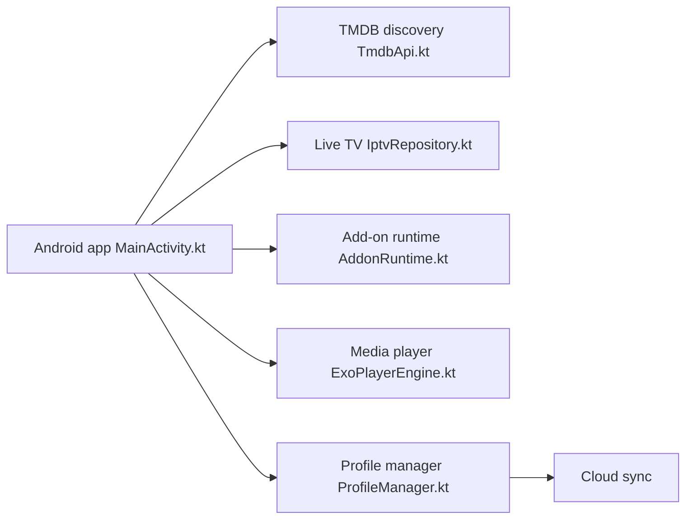

# ARVIO

> Application média pour Android TV, mobile et web, agrégeant tes propres sources, serveurs et listes de suivi.

## Le problème
Catalogues, serveurs domestiques, TV en direct, add-ons et suivi sont éparpillés dans des applications différentes.

## Ce que ça fait vraiment
Fournit accueil, collections, calendrier, Plex, Emby et Jellyfin, TV en direct (M3U, Xtream, Stalker), add-ons communautaires, débrideurs, recherche Telegram, suivi Trakt et SIMKL, sous-titres et profils. Ne contient aucun contenu : tu connectes tes sources autorisées. Web auto-hébergeable.

## Comment c'est branché


## Essayer
```bash
git clone https://github.com/ProdigyV21/ARVIO.git
cd ARVIO
cp secrets.defaults.properties secrets.properties
./gradlew :app:assembleSideloadDebug
```

## Coût et pièges
Application Android gratuite ; la version web hébergée exige ARVIO Premium ; l'auto-hébergement est libre. Clés TMDB, Trakt, SIMKL à fournir. Rapports de plantage Firebase dans les builds de production.

## Ce que ce n'est pas
Pas un fournisseur de contenu : sans sources, aucun contenu lisible. Les add-ons communautaires et les débrideurs posent la question des droits, à ta charge.

## Alternatives
Aucune alternative nommée dans le README.

## Pour toi
À ignorer : application de streaming grand public, sans rapport avec la data ou l'IA, avec des risques de droits d'auteur.

