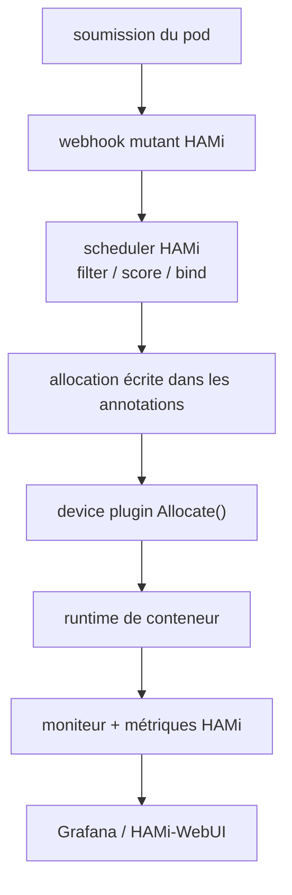

# Project-HAMi/HAMi

> Kubernetes middleware for GPU virtualization and heterogeneous accelerator scheduling.

## The problem
A whole GPU allocated to a notebook that uses 3 GB, teams fighting over cards, and a scheduler that knows nothing about device topology: utilization collapses.

## What it actually does
Lets you request a fraction of an accelerator by memory, cores or number of devices, and enforces memory and compute limits per workload when the device backend allows it. Schedules with device-aware policies: binpack, spread, topology-aware, and dynamic MIG on supported cards and modes. Covers NVIDIA GPUs, NPUs, HCUs, MLUs and other types (Ascend, Cambricon, Hygon, Iluvatar, Kunlunxin, MetaX, Moore Threads) in a single allocation flow. No application changes: you keep writing standard Kubernetes `requests`/`limits`. Exposes metrics on the scheduler monitor endpoint, with Grafana dashboards and a WebUI. CNCF incubating project.

## How it is wired


## Trying it
```bash
kubectl label nodes <node-name> gpu=on
helm repo add hami-charts https://project-hami.github.io/HAMi/
helm repo update
helm install hami hami-charts/hami -n kube-system
kubectl get pods -n kube-system
kubectl apply -f examples/nvidia/default_use.yaml
```
Requesting one GPU capped at 3 GiB:
```yaml
resources:
  limits:
    nvidia.com/gpu: 1
    nvidia.com/gpumem: 3000
```

## Cost and gotchas
Free. Strict NVIDIA prerequisites: driver ≥ 440, `nvidia-docker` > 2.0, NVIDIA as the default runtime, Kubernetes ≥ 1.23, glibc ≥ 2.17, kernel ≥ 3.10, Helm > 3.0. Semantics trap: after installation, `nvidia.com/gpu` on the node equals the number of vGPUs, whereas in a pod it denotes the number of physical GPUs.

## What it is not
Not guaranteed isolation everywhere: enforcement of limits depends on support from the device backend. Not a scheduler replacement: it plugs into the kube-scheduler path and combines with Volcano. Not a quota tool in the billing sense: that layer remains to be built on top.

## Alternatives
- NVIDIA GPU Operator: manages drivers and can coexist, but does not schedule fractions.
- Volcano: gang scheduling and batch queues, complementary rather than competing.
- Kueue: job queueing, fed by HAMi resources via ResourceTransformation.

## For you
The building block to know for sharing GPUs between notebooks and training jobs on a cluster.
