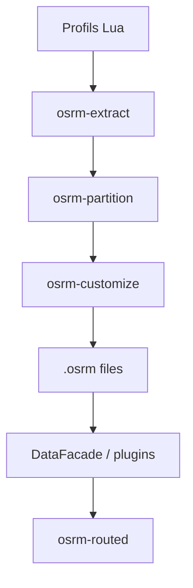

# Project-OSRM/osrm-backend

> C++ routing engine on OpenStreetMap data, for people who host their own routing.

## The problem
Computing trips, duration matrices or GPS trace matching without depending on a paid mapping API.

## What it actually does
OSRM preprocesses an OpenStreetMap extract (extraction, partition, customization, or contraction), then `osrm-routed` serves an HTTP API: Nearest, Route, Table, Match, Trip, Tile. Lua profiles tune behavior per transport mode. Node.js and Python bindings provide read access.

## How it is wired


## Trying it
```bash
wget http://download.geofabrik.de/europe/germany/berlin-latest.osm.pbf
docker run -t -v "${PWD}:/data" ghcr.io/project-osrm/osrm-backend osrm-extract -p /opt/car.lua /data/berlin-latest.osm.pbf
docker run -t -v "${PWD}:/data" ghcr.io/project-osrm/osrm-backend osrm-partition /data/berlin-latest.osrm
docker run -t -v "${PWD}:/data" ghcr.io/project-osrm/osrm-backend osrm-customize /data/berlin-latest.osrm
docker run -t -i -p 5000:5000 -v "${PWD}:/data" ghcr.io/project-osrm/osrm-backend osrm-routed --algorithm mld /data/berlin-latest.osrm
curl "http://127.0.0.1:5000/route/v1/driving/13.388860,52.517037;13.385983,52.496891?steps=true"
```

## Cost and gotchas
Free, but extraction is slow (about 30 minutes for 550 MB according to the README) and the generated files are large. The public demo server has a usage policy.

## What it is not
It is not a map nor a geocoding service: it routes on data you provide. It does not update itself, you have to reprocess the extract.

## Alternatives
No alternative named in the README.

## For you
Worth watching: useful if you do logistics or geospatial analysis (distance matrices, map matching), with a Docker setup cost.
