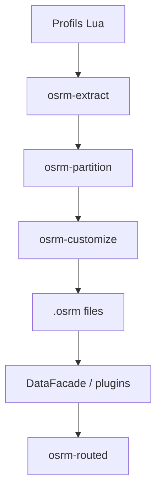

# Project-OSRM/osrm-backend

> Moteur de calcul d'itinéraires en C++ sur données OpenStreetMap, pour qui héberge son propre routage.

## Le problème
Calculer des trajets, matrices de durées ou recalages de traces GPS sans dépendre d'une API cartographique payante.

## Ce que ça fait vraiment
OSRM prétraite un extrait OpenStreetMap (extraction, partition, personnalisation, ou contraction), puis `osrm-routed` sert une API HTTP : Nearest, Route, Table, Match, Trip, Tile. Les profils Lua règlent le comportement par mode de transport. Des liaisons Node.js et Python donnent un accès en lecture.

## Comment c'est branché


## Essayer
```bash
wget http://download.geofabrik.de/europe/germany/berlin-latest.osm.pbf
docker run -t -v "${PWD}:/data" ghcr.io/project-osrm/osrm-backend osrm-extract -p /opt/car.lua /data/berlin-latest.osm.pbf
docker run -t -v "${PWD}:/data" ghcr.io/project-osrm/osrm-backend osrm-partition /data/berlin-latest.osrm
docker run -t -v "${PWD}:/data" ghcr.io/project-osrm/osrm-backend osrm-customize /data/berlin-latest.osrm
docker run -t -i -p 5000:5000 -v "${PWD}:/data" ghcr.io/project-osrm/osrm-backend osrm-routed --algorithm mld /data/berlin-latest.osrm
curl "http://127.0.0.1:5000/route/v1/driving/13.388860,52.517037;13.385983,52.496891?steps=true"
```

## Coût et pièges
Gratuit, mais l'extraction est longue (environ 30 minutes pour 550 Mo selon le README) et les fichiers générés sont volumineux. Le serveur de démo public a une politique d'usage.

## Ce que ce n'est pas
Ce n'est pas une carte ni un service de géocodage : il route sur des données que tu fournis. Il ne se met pas à jour tout seul, il faut retraiter l'extrait.

## Alternatives
Aucune alternative nommée dans le README.

## Pour toi
À surveiller : utile si tu fais de la logistique ou de l'analyse géospatiale (matrices de distances, map matching), avec un coût de mise en place en Docker.

