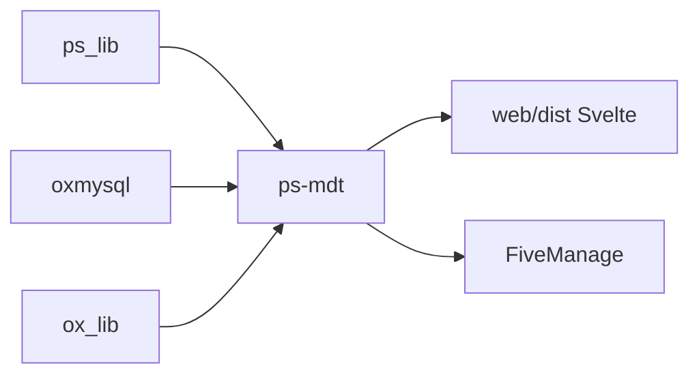

# Project-Sloth/ps-mdt

> In-game police terminal for FiveM servers (QBCore/QBX), for roleplay server administrators.

## The problem
A police roleplay server needs an in-car computer for reports, warrants, evidence, impound and dispatch.

## What it actually does
FiveM resource in Lua with a Svelte 5 interface: citizen records, collaborative reports, cases, evidence, warrants, BOLOs, vehicles, weapons, cameras, bodycams, patrol map, radio, court, internal affairs. 62 per-role permissions; audit log stored in the database. Image uploads go through FiveManage.

## How it is wired


## Trying it
```bash
cd resources/[qb]/ps-mdt/web
npm install
npm run build
```
Then in `server.cfg`: `ensure ps_lib`, `ensure oxmysql`, `ensure ox_lib`, `ensure ps-mdt`.

## Cost and gotchas
FiveManage keys (images, logs) must be created; SQL database to import (`sql/qbcore.sql`); DOJ jobs to modify in `qb-core`. No backward compatibility with ps-mdt v1. The end of the README is a VPS host advertisement.

## What it is not
Not a data tool: it is a game mod. License present but not identified.

## Alternatives
No alternative named; ps-dispatch is a recommended companion.

## For you
Ignore: a FiveM mod unrelated to data/AI/MLOps.
