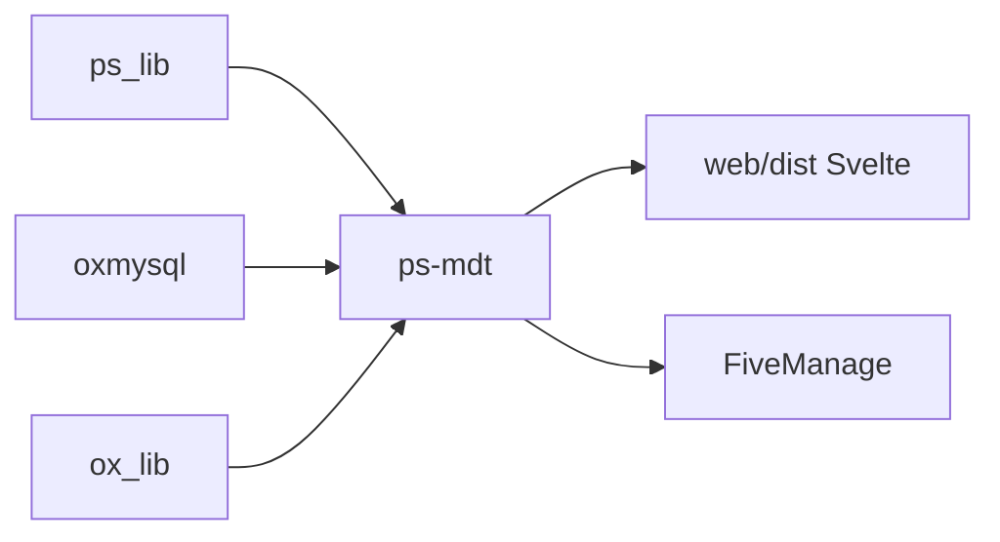

# Project-Sloth/ps-mdt

> Terminal de police en jeu pour serveurs FiveM (QBCore/QBX), pour administrateurs de serveurs de jeu de rôle.

## Le problème
Un serveur de jeu de rôle policier a besoin d'un ordinateur de bord pour rapports, mandats, preuves, fourrière et dispatch.

## Ce que ça fait vraiment
Ressource FiveM en Lua avec interface Svelte 5 : fiches citoyens, rapports collaboratifs, affaires, preuves, mandats, BOLO, véhicules, armes, caméras, bodycams, carte des patrouilles, radio, tribunal, affaires internes. 62 permissions par rôle ; journal d'audit stocké en base. Les envois d'images passent par FiveManage.

## Comment c'est branché


## Essayer
```bash
cd resources/[qb]/ps-mdt/web
npm install
npm run build
```
Puis dans `server.cfg` : `ensure ps_lib`, `ensure oxmysql`, `ensure ox_lib`, `ensure ps-mdt`.

## Coût et pièges
Clés FiveManage (images, logs) à créer ; base SQL à importer (`sql/qbcore.sql`) ; jobs DOJ à modifier dans `qb-core`. Aucune rétrocompatibilité avec ps-mdt v1. La fin du README est une publicité d'hébergeur VPS.

## Ce que ce n'est pas
Pas un outil de données : c'est un mod de jeu. Licence présente mais non identifiée.

## Alternatives
Aucune alternative nommée ; ps-dispatch est un complément recommandé.

## Pour toi
À ignorer : un mod FiveM sans rapport avec data/IA/MLOps.

