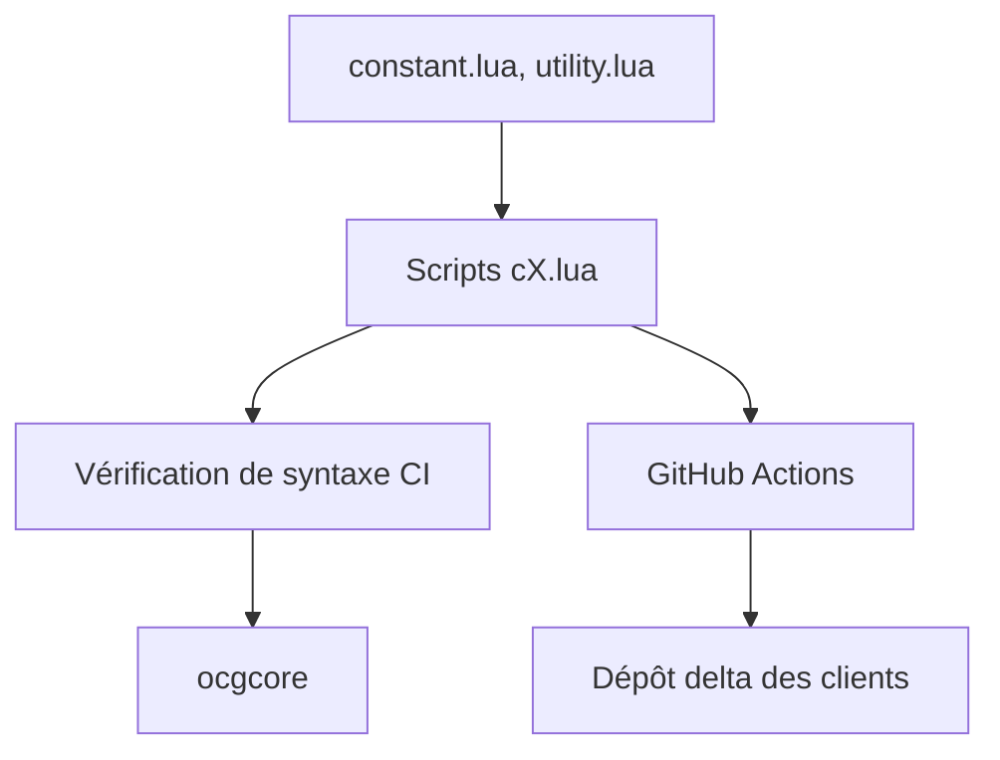

# ProjectIgnis/CardScripts

> Collection of Lua scripts for the cards of the game EDOPro, including official and unofficial cards.

## The problem
A card game simulator needs the rules of each card as exact scripts.

## What it actually does
The repository contains the Lua 5.3 card scripts for the `ocgcore` engine, along with constants and utilities (summoning procedures). A syntax check loads the scripts into the engine on every push. A GitHub Actions workflow syncs the modified scripts to the clients' delta repository.

## How it is wired
Simplified diagram based on the sheet, no diagram provided.



## Trying it
```bash
# Aucune commande documentée dans le README
```

## Cost and gotchas
Free. No license declared. The syntax check does not catch runtime errors outside `initial_effect`.

## What it is not
Not a game or an engine: only the card scripts, usable with EDOPro.

## Alternatives
None cited in the README.

## For you
Ignore: card game scripts, unrelated to a data / AI / MLOps profile.
