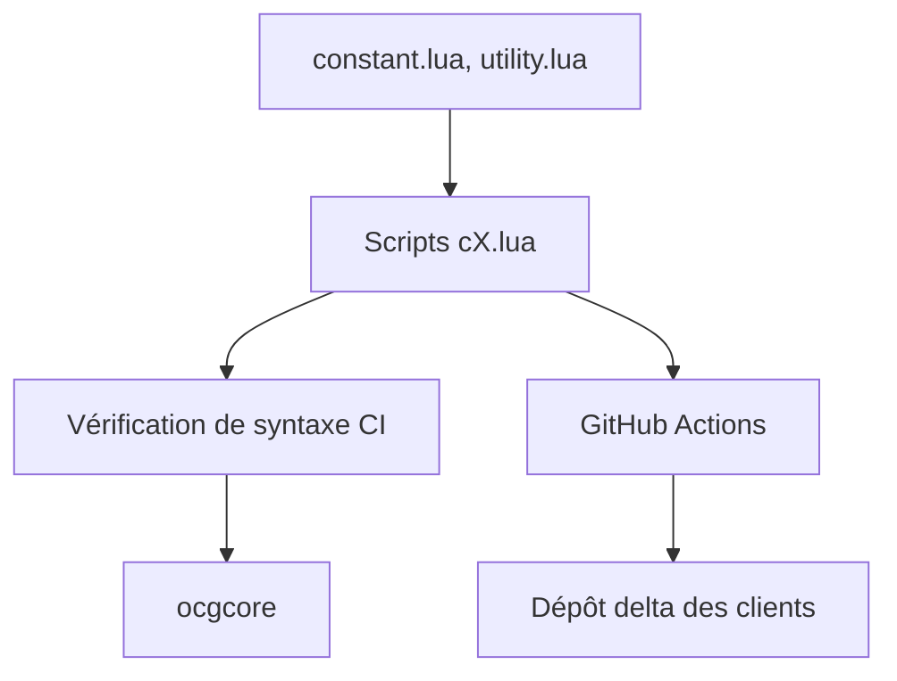

# ProjectIgnis/CardScripts

> Collection de scripts Lua des cartes du jeu EDOPro, dont les cartes officielles et non officielles.

## Le problème
Un simulateur de jeu de cartes a besoin des règles de chaque carte sous forme de scripts exacts.

## Ce que ça fait vraiment
Le dépôt contient les scripts Lua 5.3 des cartes pour le moteur `ocgcore`, ainsi que des constantes et utilitaires (procédures d'invocation). Une vérification de syntaxe charge les scripts dans le moteur à chaque push. Un workflow GitHub Actions synchronise les scripts modifiés vers le dépôt delta des clients.

## Comment c'est branché
Schéma simplifié d'après la fiche, sans diagramme fourni.



## Essayer
```bash
# Aucune commande documentée dans le README
```

## Coût et pièges
Gratuit. Aucune licence déclarée. La vérification de syntaxe n'attrape pas les erreurs d'exécution hors `initial_effect`.

## Ce que ce n'est pas
Pas un jeu ni un moteur : seulement les scripts de cartes, utilisables avec EDOPro.

## Alternatives
Aucune citée dans le README.

## Pour toi
Ignorer : scripts de jeu de cartes, sans lien avec un profil data / IA / MLOps.

