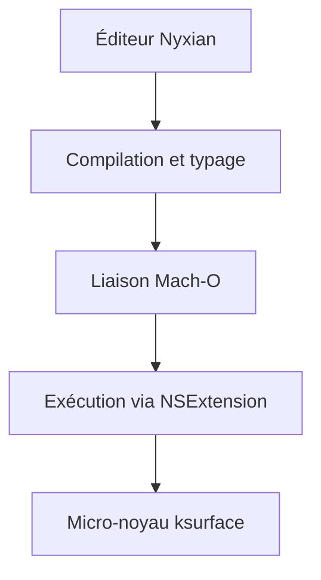

# ProjectNyxian/Nyxian

> Offline iOS IDE that compiles and runs iOS applications directly on the iPhone.

## The problem
Developing for iOS requires a Mac; the author wants a complete toolchain on the iPhone, even offline.

## What it actually does
Compiles Swift, C, Objective-C, C++ and Objective-C++, type-checks, links objects into Mach-O and runs the code via NSExtension. The project ships a microkernel (ksurface), a kext linker, a Mach IPC system call server and subprocess patches. The SDK is downloaded from the project's server on first use. Indexing is not done.

## How it is wired
Simplified diagram based on the sheet, no diagram provided.

## Trying it
No command: follow the installation guide indicated in the README.

## Cost and gotchas
Free. The SDK download from the project's server is required the first time. No license declared. iOS 18.0 or later; the admitted limitation concerns arm64 system call interception.

## What it is not
Not a documented substitute for Xcode: the README is a to-do list, with no user guide. It uses workarounds for iOS protections.

## Alternatives
No alternative named in the README.

## For you
Ignore: experimental, unlicensed, dependent on the project's server and unrelated to data, AI or MLOps work.
