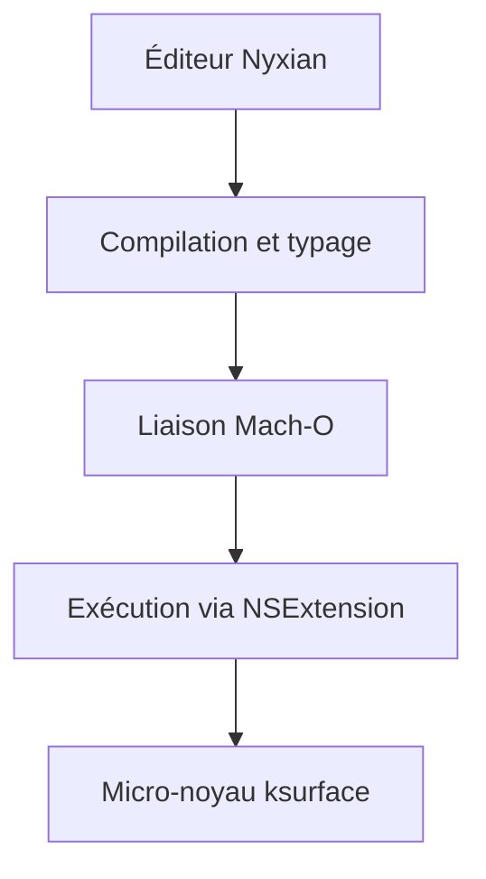

# ProjectNyxian/Nyxian

> IDE iOS hors ligne qui compile et exécute des applications iOS directement sur l'iPhone.

## Le problème
Développer pour iOS suppose un Mac ; l'auteur veut une chaîne complète sur l'iPhone, même hors connexion.

## Ce que ça fait vraiment
Compile Swift, C, Objective-C, C++ et Objective-C++, vérifie les types, lie les objets en Mach-O et exécute le code via NSExtension. Le projet embarque un micro-noyau (ksurface), un éditeur de liens de kext, un serveur d'appels système Mach IPC et des correctifs de sous-processus. Le SDK est téléchargé depuis le serveur du projet à la première utilisation. Indexation non faite.

## Comment c'est branché
Schéma simplifié d'après la fiche, sans diagramme fourni.

## Essayer
Aucune commande : suivre le guide d'installation indiqué dans le README.

## Coût et pièges
Gratuit. Téléchargement du SDK depuis le serveur du projet requis une première fois. Aucune licence déclarée. iOS 18.0 ou plus ; la limite avouée concerne l'interception des appels système arm64.

## Ce que ce n'est pas
Pas un substitut documenté à Xcode : le README est une liste de tâches, sans mode d'emploi. Il emploie des contournements de protections iOS.

## Alternatives
Aucune alternative nommée dans le README.

## Pour toi
Ignorer : expérimental, sans licence, tributaire du serveur du projet et sans rapport avec le travail data, IA ou MLOps.

