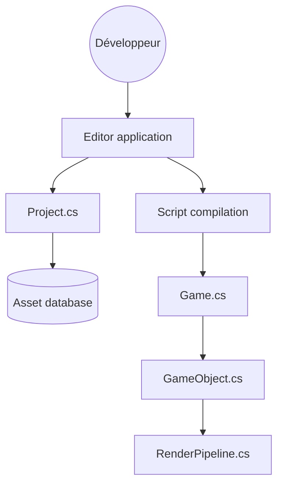

# ProwlEngine/Prowl

> Open-source C# game engine close to Unity, with a full editor, for game developers.

## The problem
Unity and Unreal are proprietary; there is a lack of a free, small and customizable engine with a familiar API.

## What it actually does
Editor (scene, inspector, project browser), standalone runtime, Vulkan rendering, Jitter physics, audio, navigation, animation, OpenXR VR and C# scripts compiled with Roslyn. A CLI lets you drive the editor from scripts or AI agents. Version 1.0 Preview 5: breaking changes expected.

## How it is wired


## Trying it
```bash
# Cloner le dépôt, ouvrir Prowl.slnx (Visual Studio, VSCode ou Rider)
# puis compiler et lancer Prowl.Editor
```

## Cost and gotchas
Free. Requires .NET 10 and a Vulkan 1.2-compatible GPU (MoltenVK on macOS). Android still in development.

## What it is not
Not a finished engine: version 1.0 is not out and migration between previews is not guaranteed.

## Alternatives
No alternative named in the README (it cites Unity as the API reference).

## For you
Ignore: a game engine outside your data and AI scope, still in preview.
