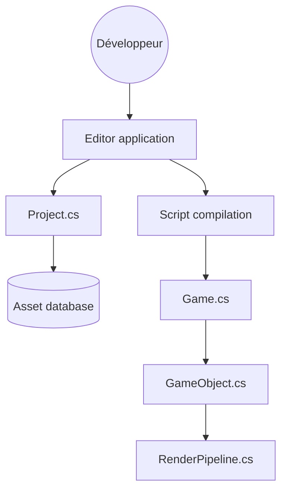

# ProwlEngine/Prowl

> Moteur de jeu open source en C# proche d'Unity, avec éditeur complet, pour développeurs de jeux.

## Le problème
Unity et Unreal sont propriétaires ; il manque un moteur libre, petit et personnalisable avec une API familière.

## Ce que ça fait vraiment
Éditeur (scène, inspecteur, navigateur de projet), runtime autonome, rendu Vulkan, physique Jitter, audio, navigation, animation, VR OpenXR et scripts C# compilés avec Roslyn. Une CLI permet de piloter l'éditeur depuis des scripts ou des agents IA. Version 1.0 Preview 5 : changements cassants attendus.

## Comment c'est branché


## Essayer
```bash
# Cloner le dépôt, ouvrir Prowl.slnx (Visual Studio, VSCode ou Rider)
# puis compiler et lancer Prowl.Editor
```

## Coût et pièges
Gratuit. Demande .NET 10 et un GPU compatible Vulkan 1.2 (MoltenVK sur macOS). Android encore en développement.

## Ce que ce n'est pas
Pas un moteur finalisé : la version 1.0 n'est pas sortie et la migration entre previews n'est pas garantie.

## Alternatives
Aucune alternative nommée dans le README (il cite Unity comme référence d'API).

## Pour toi
À ignorer : moteur de jeu hors de ton périmètre data et IA, encore en preview.

