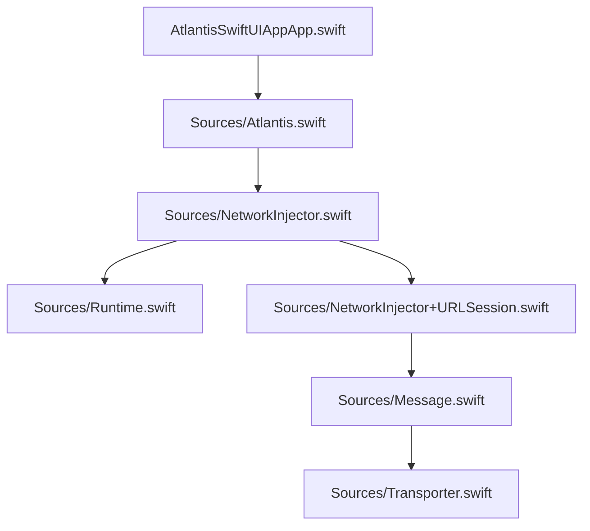

# ProxymanApp/atlantis

> iOS and Android library that sends an app's HTTP/HTTPS traffic to Proxyman, without a proxy.

## The problem
Debugging a mobile app's network traffic normally requires configuring a proxy and installing a certificate.

## What it actually does
`Atlantis.start` activates NetworkInjector, which intercepts URLSession and network sessions through the Objective-C runtime. Requests and responses are wrapped in Messages and then sent by Transporter to the Proxyman macOS application, discovered through Bonjour. Also captures WebSocket and gRPC (through an interceptor). An Android version works through OkHttp, Retrofit and Apollo.

## How it is wired


## Trying it
```swift
#if DEBUG
import Atlantis
#endif

// dans l'initialisation de l'application
#if DEBUG
Atlantis.start()
#endif
```
Installation: add `https://github.com/ProxymanApp/atlantis` as a Swift Package, then add the NSLocalNetworkUsageDescription and NSBonjourServices keys to Info.plist.

## Cost and gotchas
The library is free, but it requires the Proxyman macOS application. The debugging tools (Map Local, Breakpoint, Scripting) do not work with Atlantis. Third-party WebSocket libraries (Starscream) are not captured.

## What it is not
Does not replace a full proxy: use it only in debug builds, never in production despite what the README mentions.

## Alternatives
No alternative named in the README.

## For you
Ignore: a mobile app debugging tool tied to Proxyman, of no interest for a data, AI or MLOps profile.
