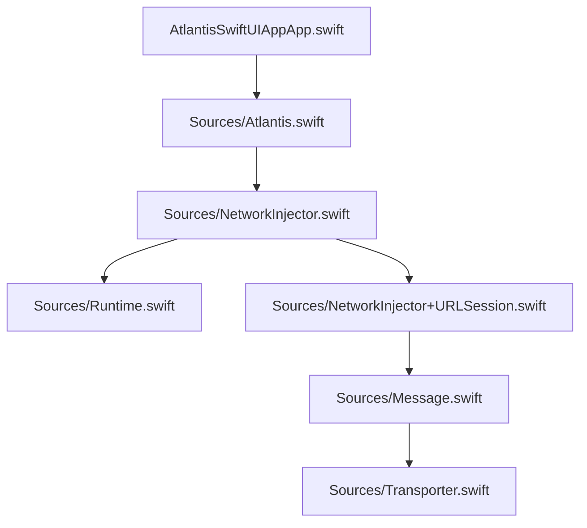

# ProxymanApp/atlantis

> Bibliothèque iOS et Android qui envoie le trafic HTTP/HTTPS d'une application à Proxyman, sans proxy.

## Le problème
Déboguer le trafic réseau d'une application mobile demande normalement de configurer un proxy et d'installer un certificat.

## Ce que ça fait vraiment
`Atlantis.start` active NetworkInjector, qui intercepte URLSession et les sessions réseau via le runtime Objective-C. Les requêtes et réponses sont emballées dans des Message puis envoyées par Transporter à l'application macOS Proxyman, découverte par Bonjour. Capture aussi WebSocket et gRPC (par intercepteur). Une version Android passe par OkHttp, Retrofit et Apollo.

## Comment c'est branché


## Essayer
```swift
#if DEBUG
import Atlantis
#endif

// dans l'initialisation de l'application
#if DEBUG
Atlantis.start()
#endif
```
Installation : ajouter `https://github.com/ProxymanApp/atlantis` en Swift Package, puis les clés NSLocalNetworkUsageDescription et NSBonjourServices dans Info.plist.

## Coût et pièges
Bibliothèque gratuite, mais elle nécessite l'application macOS Proxyman. Les outils de débogage (Map Local, Breakpoint, Scripting) ne fonctionnent pas avec Atlantis. Les bibliothèques WebSocket tierces (Starscream) ne sont pas capturées.

## Ce que ce n'est pas
Ne remplace pas un proxy complet : à utiliser seulement en build de debug, jamais en production malgré la mention du README.

## Alternatives
Aucune alternative nommée dans le README.

## Pour toi
À ignorer : outil de débogage d'apps mobiles lié à Proxyman, sans intérêt pour un profil data, IA ou MLOps.

