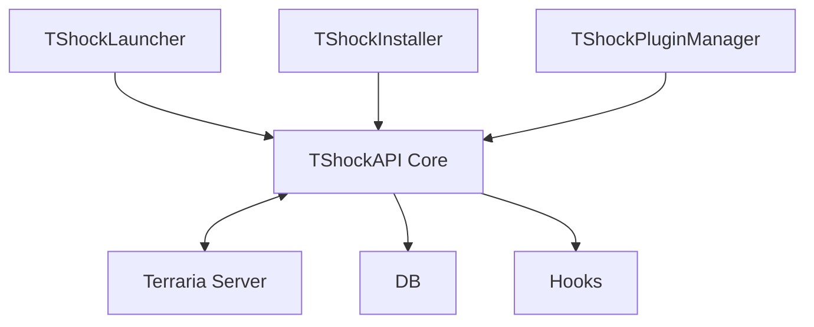

# Pryaxis/TShock

> Terraria server toolkit: permissions, commands, anti-cheat and plugin API.

## The problem
A standard Terraria server offers no group management, no rights, and no protection against cheating.

## What it actually does
Hooks into the Terraria server through OTAPI with direct access to the `Terraria` namespace. Provides accounts, groups, permissions, item bans, many commands. The repository contains TShockAPI (core), TShockLauncher, TShockInstaller and TShockPluginManager.

## How it is wired
Diagram based on the code diagram.



## Trying it
```bash
git clone https://github.com/Pryaxis/TShock.git --recurse-submodules
cd TShock
dotnet build
dotnet run --project TShockLauncher
```

## Cost and gotchas
Free, .NET 9 SDK required (not in the list of possible prerequisites). Decompiled Terraria sources are only provided to contributors; otherwise use ILSpy. GPL-3.0 license: copyleft.

## What it is not
Not a game nor a general-purpose tool; the README is aimed at developers, operator documentation is still under construction.

## Alternatives
CraftBukkit, cited only by analogy for direct access to the game's internals.

## For you
Ignore: off-topic for data/AI/MLOps, only useful if you host a Terraria server.
