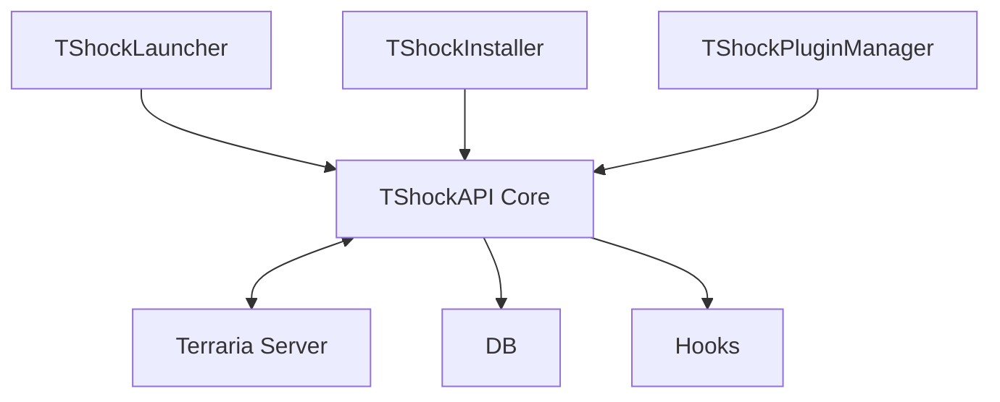

# Pryaxis/TShock

> Boîte à outils de serveur Terraria : permissions, commandes, anti-triche et API de plugins.

## Le problème
Un serveur Terraria standard n'offre ni gestion de groupes, ni droits, ni protection contre la triche.

## Ce que ça fait vraiment
S'insère dans le serveur Terraria via OTAPI avec accès direct à l'espace de noms `Terraria`. Apporte comptes, groupes, permissions, interdiction d'objets, nombreuses commandes. Le dépôt contient TShockAPI (cœur), TShockLauncher, TShockInstaller et TShockPluginManager.

## Comment c'est branché
Schéma d'après le diagramme du code.



## Essayer
```bash
git clone https://github.com/Pryaxis/TShock.git --recurse-submodules
cd TShock
dotnet build
dotnet run --project TShockLauncher
```

## Coût et pièges
Gratuit, SDK .NET 9 requis (non listé dans les prérequis possibles). Les sources décompilées de Terraria ne sont fournies qu'aux contributeurs ; sinon passer par ILSpy. Licence GPL-3.0 : copyleft.

## Ce que ce n'est pas
Pas un jeu ni un outil généraliste ; le README s'adresse aux développeurs, la documentation opérateur est encore en construction.

## Alternatives
CraftBukkit, cité seulement par analogie pour l'accès direct aux internes du jeu.

## Pour toi
À ignorer : hors sujet data/IA/MLOps, utile seulement si tu héberges un serveur Terraria.

