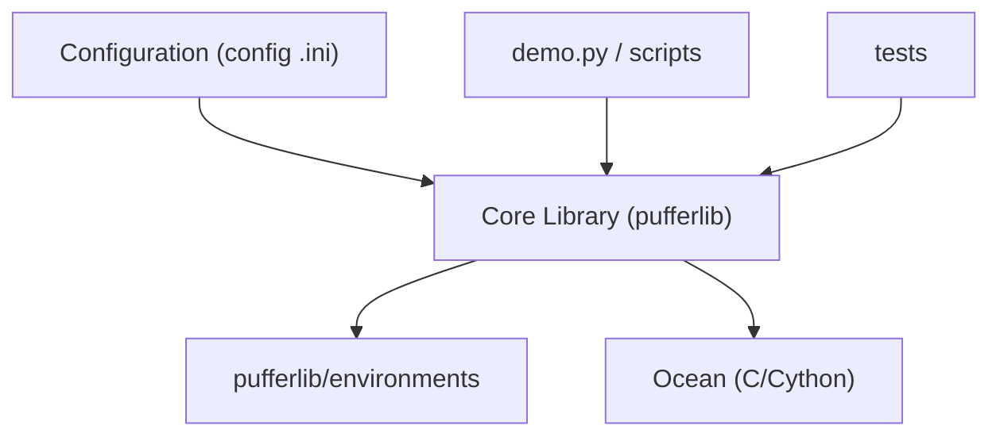

# PufferAI/PufferLib

> Python reinforcement learning library that trains small models very fast, for researchers and industry.

## The problem
Training a reinforcement learning agent on varied environments requires adapting each API and handling slow simulations.

## What it actually does
A Python core (environment emulation, models, vectorization, cleanrl) unifies access to many environments: Atari, Box2D, nethack, etc. An "ocean" subsystem in C/Cython speeds up critical environments. `.ini` files configure runs and scripts launch training. The team also offers paid support.

## How it is wired
Diagram taken from the code, simplified.



## Trying it
No installation command in the provided README; the documentation is hosted on puffer.ai.

```bash
# non documenté dans le README : voir puffer.ai
```

## Cost and gotchas
Free library, paid support and custom environments. Support goes through Discord before opening an issue. The C/Cython extensions require compilation.

## What it is not
Not a managed service nor a catalog of ready-to-use agents. The speed figures come from the authors, not verified here.

## Alternatives
No alternative named in the README.

## For you
Adopt if you do reinforcement learning: it bundles environments, vectorization and training in a maintained base.
