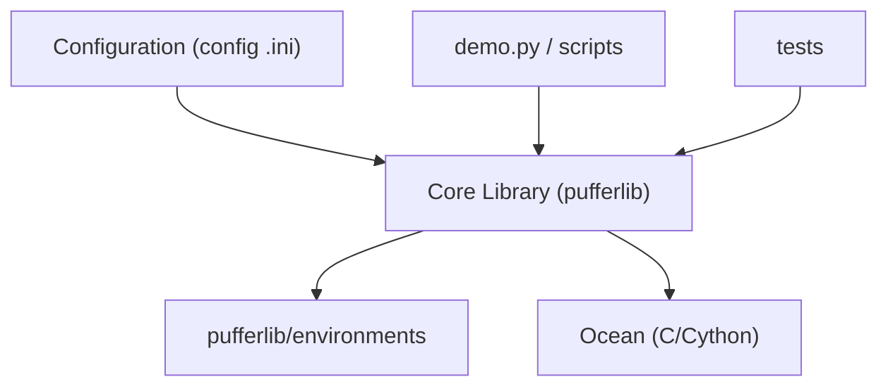

# PufferAI/PufferLib

> Bibliothèque Python d'apprentissage par renforcement qui entraîne de petits modèles très vite, pour chercheurs et industriels.

## Le problème
Entraîner un agent d'apprentissage par renforcement sur des environnements variés demande d'adapter chaque API et de gérer des simulations lentes.

## Ce que ça fait vraiment
Un noyau Python (émulation d'environnements, modèles, vectorisation, cleanrl) unifie l'accès à de nombreux environnements : Atari, Box2D, nethack, etc. Un sous-système « ocean » en C/Cython accélère des environnements critiques. Des fichiers `.ini` configurent les essais et des scripts lancent l'entraînement. L'équipe propose aussi du soutien payant.

## Comment c'est branché
Diagramme tiré du code, simplifié.



## Essayer
Aucune commande d'installation dans le README fourni ; la documentation est hébergée sur puffer.ai.

```bash
# non documenté dans le README : voir puffer.ai
```

## Coût et pièges
Bibliothèque gratuite, soutien et environnements sur mesure payants. Le support passe par Discord avant d'ouvrir une issue. Les extensions C/Cython supposent une compilation.

## Ce que ce n'est pas
Pas un service géré ni un catalogue d'agents prêts à l'emploi. Les chiffres de vitesse viennent des auteurs, non vérifiés ici.

## Alternatives
Aucune alternative nommée dans le README.

## Pour toi
À adopter si tu fais de l'apprentissage par renforcement : il regroupe environnements, vectorisation et entraînement dans une base maintenue.

