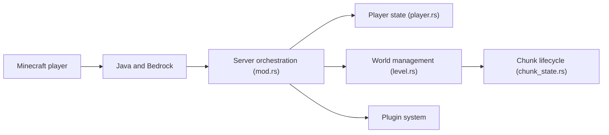

# Pumpkin-MC/Pumpkin

> Minecraft server written in Rust, multithreaded, for hosts wanting a lightweight alternative.

## The problem
Classic Minecraft servers consume a lot of resources and lend themselves poorly to customization.

## What it actually does
A Java and Bedrock (in progress) server handling protocol, encryption, compression, worlds, chunks, lighting, entities, inventories, commands and permissions, with TOML configuration. A plugin system, a management protocol (MSMP) and proxy compatibility (BungeeCord, Velocity) exist. The README states that the project is under heavy development before 1.0.

## How it is wired

## Trying it
The README points to a getting-started guide and contains no command. No documented command.

## Cost and gotchas
Free. Under active development: incomplete features (mobs, advancements, Bedrock in progress). 793 open issues.

## What it is not
Not a complete replacement for the vanilla server at this stage. Not a guaranteed production tool.

## Alternatives
No alternative named in the README.

## For you
Ignore: a game server unrelated to data/AI/MLOps, and still experimental.
