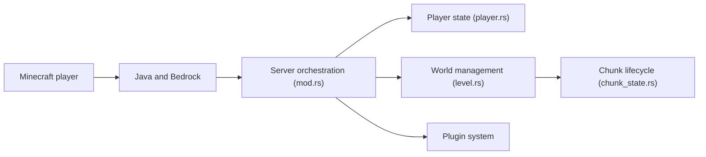

# Pumpkin-MC/Pumpkin

> Serveur Minecraft écrit en Rust, multithread, pour les hébergeurs voulant une alternative légère.

## Le problème
Les serveurs Minecraft classiques consomment beaucoup de ressources et se prêtent peu à la personnalisation.

## Ce que ça fait vraiment
Un serveur Java et Bedrock (en cours) gère protocole, chiffrement, compression, mondes, chunks, lumière, entités, inventaires, commandes et permissions, avec configuration en TOML. Un système de plugins, un protocole de gestion (MSMP) et la compatibilité proxys (BungeeCord, Velocity) existent. Le README précise que le projet est en plein développement avant la 1.0.

## Comment c'est branché

## Essayer
Le README renvoie à un guide de démarrage et ne contient aucune commande. Aucune commande documentée.

## Coût et pièges
Gratuit. En développement actif : fonctions incomplètes (mobs, advancements, Bedrock en cours). 793 issues ouvertes.

## Ce que ce n'est pas
Pas un remplaçant complet du serveur vanilla à ce stade. Pas un outil de production garanti.

## Alternatives
Aucune alternative nommée dans le README.

## Pour toi
Ignorer : serveur de jeu sans rapport avec la data/IA/MLOps, et encore expérimental.

