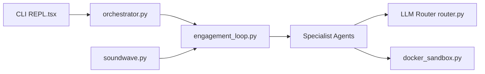

# PurpleAILAB/Decepticon

> Autonomous LLM-driven red team agent, for authorized offensive teams working under rules of engagement.

## The problem
Red team exercises are long, manual and hard to document. "AI + security" demos often boil down to launching a scanner and printing a report.

## What it actually does
- First generates an engagement dossier (ConOps, rules of engagement, deconfliction plan, OPPLAN aligned with MITRE ATT&CK) via `soundwave.py`.
- An orchestration loop (`engagement_loop.py`) takes each objective, launches a specialist agent with fresh context and classifies the result: succeeded, blocked or pending.
- 16 per-phase agents, run in an isolated Kali sandbox on a dedicated network; findings go into a Neo4j graph.
- Guardrails (`middleware/`) and logging serve as an audit trail.

## How it is wired


## Trying it
```bash
curl -fsSL https://decepticon.red/install | bash
decepticon onboard   # Interactive setup wizard (provider, API key, model profile)
decepticon           # Start the core stack and drop into the terminal CLI
pip install decepticon              # core SDK
pip install "decepticon[neo4j]"     # + the knowledge-graph attack-chain tools
```

## Cost and gotchas
Docker and Docker Compose v2 required; an LLM provider API key (or OAuth subscription) at your expense, the bill depends on the profile (eco, max, test). The install script goes through `curl | bash`.

## What it is not
Not a scanner nor a mainstream tool: the README requires explicit written authorization from the system owner, without which use is illegal. The pip SDK is not enough: you need the runtime services (LLM proxy, sandbox). License not declared in the catalog.

## Alternatives
- Strix, PentestGPT, MAPTA, Cyber-AutoAgent: compared in the repository README (benchmark page), to be evaluated for your case.

## For you
Worth watching: interesting as a study of autonomous multi-role agents with guardrails, but an offensive domain, undeclared license and use strictly reserved for authorized missions, so of little use for a data / MLOps profile.
