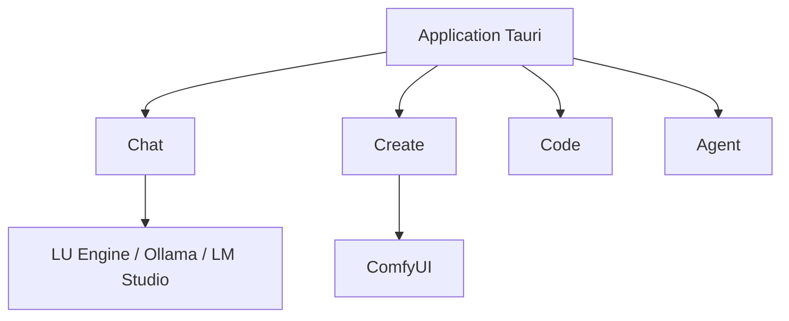

# PurpleDoubleD/locally-uncensored

> Local desktop application bringing together chat, images, video and a coding agent, for those who want everything local.

## The problem
Chat, image generation, video and a coding agent live in separate tools, to be installed and configured one by one.

## What it actually does
A Tauri window with four tabs: Chat, Create (ComfyUI installed and driven by the app), Code (an agent that shows the diff before applying) and Agent (web search, files, shell, MCP). It detects twelve local engines including Ollama and LM Studio, or uses its own LU Engine. Remote access from the phone and a paid cloud option, LU Labs.

## How it is wired
Simplified diagram based on the sheet, no diagram provided.


## Trying it
```bash
git clone https://github.com/PurpleDoubleD/locally-uncensored.git
cd locally-uncensored
npm install
npm run dev
npm run tauri build
```

## Cost and gotchas
Free locally; the LU Labs cloud is paid (plans or credits). Images and video require 6 to 16 GB of VRAM and more. Windows installers are unsigned for now, and the Mac version is in beta.

## What it is not
Not a headless server: the README says a graphical session is required. The "no-refusal models" are modified models: no guarantee on their answers. The comparison figures come from the README itself.

## Alternatives
- Open WebUI, LM Studio, Jan, SillyTavern: compared in the README; LM Studio and Jan are simpler for chat alone.

## For you
Worth watching: handy for trying local models in a single tool, but young, run by one person and under AGPL.
