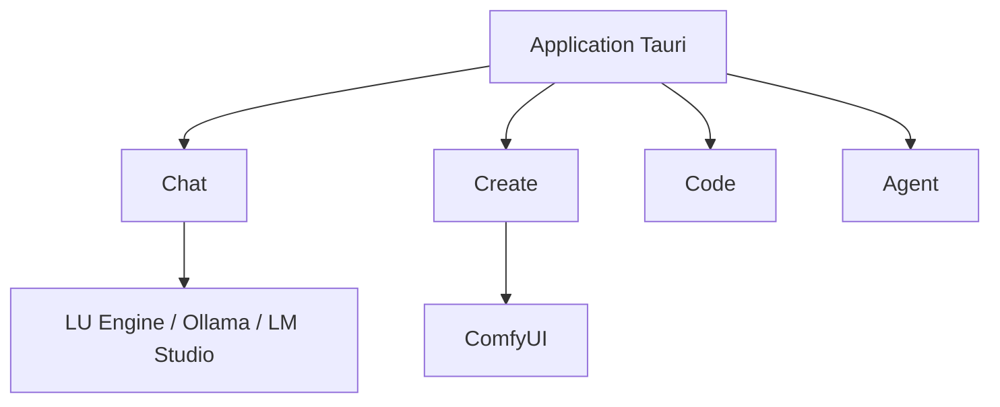

# PurpleDoubleD/locally-uncensored

> Application de bureau locale réunissant chat, images, vidéo et agent de code, pour qui veut tout en local.

## Le problème
Chat, génération d'images, vidéo et agent de code vivent dans des outils séparés, à installer et configurer un par un.

## Ce que ça fait vraiment
Une fenêtre Tauri avec quatre onglets : Chat, Create (ComfyUI installé et piloté par l'app), Code (agent qui montre le diff avant d'appliquer) et Agent (recherche web, fichiers, shell, MCP). Détecte douze moteurs locaux dont Ollama et LM Studio, ou utilise son propre LU Engine. Accès distant depuis le téléphone et option de cloud payant LU Labs.

## Comment c'est branché
Schéma simplifié d'après la fiche, sans diagramme fourni.


## Essayer
```bash
git clone https://github.com/PurpleDoubleD/locally-uncensored.git
cd locally-uncensored
npm install
npm run dev
npm run tauri build
```

## Coût et pièges
Gratuit en local ; le cloud LU Labs est payant (plans ou crédits). Les images et vidéos demandent 6 à 16 Go de VRAM et plus. Les installeurs Windows sont non signés pour l'instant, et la version Mac est en bêta.

## Ce que ce n'est pas
Pas un serveur sans écran : le README dit qu'il faut une session graphique. Les « modèles sans refus » sont des modèles modifiés : aucune garantie sur leurs réponses. Les chiffres de comparaison viennent du README lui-même.

## Alternatives
- Open WebUI, LM Studio, Jan, SillyTavern : comparés dans le README ; LM Studio et Jan sont plus simples pour le chat seul.

## Pour toi
À surveiller : pratique pour essayer des modèles locaux en un seul outil, mais jeune, mené par une personne et sous AGPL.

