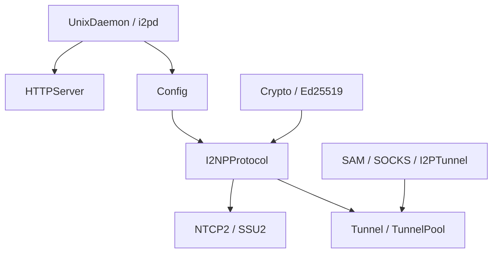

# PurpleI2P/i2pd

> C++ daemon that turns your machine into a node of the I2P anonymous network, for those who want to encrypt their exchanges.

## The problem
On the Internet, the IP addresses of both parties are visible. A network layer is needed to hide who is talking to whom.

## What it actually does
i2pd is a complete implementation of the I2P client. It builds encrypted tunnels, maintains the database of neighboring routers and exposes interfaces for applications (SAM, BOB, SOCKS, HTTP proxy). The daemon also provides an HTTP console and a control interface.

## How it is wired


## Trying it
```bash
# Aucune commande dans le README : il renvoie à la documentation et aux paquets précompilés.
```

## Cost and gotchas
Free. The README lists packages for Linux, Windows, macOS, Docker, Snap and FreeBSD, or building from source (C++). The project's policy forbids AI-generated code and issue texts.

## What it is not
Not a turnkey application: it is the network daemon, applications plug into it. The Android and Qt versions are in other repositories. The announced anonymity remains a claim of the README, not verified here.

## Alternatives
No alternative named in the README.

## For you
Ignore: an anonymous network fits no common data, AI or MLOps workflow; keep it only for a specific network privacy need.
