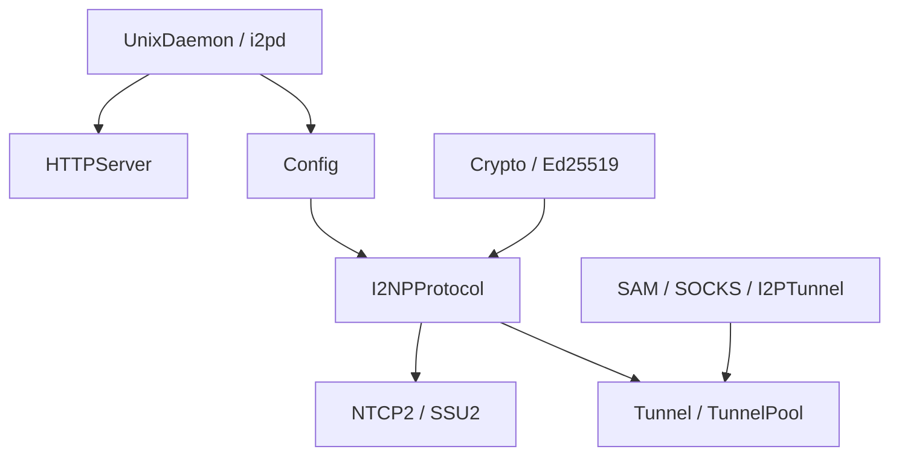

# PurpleI2P/i2pd

> Démon C++ qui fait de ta machine un nœud du réseau anonyme I2P, pour qui veut chiffrer ses échanges.

## Le problème
Sur Internet, les adresses IP des deux interlocuteurs sont visibles. Il faut une couche réseau qui cache qui parle à qui.

## Ce que ça fait vraiment
i2pd est une implémentation complète du client I2P. Il construit des tunnels chiffrés, tient la base des routeurs voisins et expose des interfaces pour les applications (SAM, BOB, SOCKS, proxy HTTP). Le démon fournit aussi une console HTTP et une interface de contrôle.

## Comment c'est branché


## Essayer
```bash
# Aucune commande dans le README : il renvoie à la documentation et aux paquets précompilés.
```

## Coût et pièges
Gratuit. Le README liste des paquets pour Linux, Windows, macOS, Docker, Snap et FreeBSD, ou une compilation depuis les sources (C++). La politique du projet interdit le code et les textes d'issues générés par une IA.

## Ce que ce n'est pas
Ce n'est pas une application clé en main : c'est le démon réseau, les applications se branchent dessus. Les versions Android et Qt sont dans d'autres dépôts. L'anonymat annoncé reste une affirmation du README, non vérifiée ici.

## Alternatives
Aucune alternative nommée dans le README.

## Pour toi
À ignorer : un réseau anonyme n'entre dans aucun flux data, IA ou MLOps courant ; ne le garder que pour un besoin précis de confidentialité réseau.

