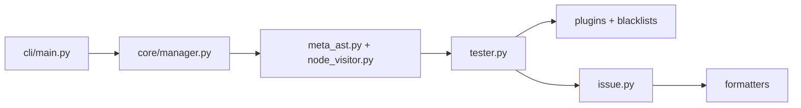

# PyCQA/bandit

> Security linter for Python code, to plug into CI or pre-commit.

## The problem
Common Python vulnerabilities (shell or SQL injection, hard-coded secrets, dangerous deserialization, misconfigured TLS) slip through code review without automatic detection.

## What it actually does
Bandit walks each file, builds the AST and applies plugins to the nodes, without running the code. A second mechanism, the blacklists, forbids certain calls and imports. Results come out as text, JSON, YAML, CSV, XML, HTML or SARIF. A baseline mode hides findings that were already accepted.

## How it is wired


## Trying it
```bash
docker pull ghcr.io/pycqa/bandit/bandit
```
The README does not document the pip command or the CLI call: it points to the online documentation.

## Cost and gotchas
Free. Image signed with cosign, multi-architecture. The README points to Read the Docs for actual usage.

## What it is not
Not dynamic analysis nor a dependency audit: only static analysis of your code's AST. 258 open issues: expect false positives and filter them with a baseline.

## Alternatives
No alternative named in the README.

## For you
Adopt: a static security scan of your Python scripts and pipelines in CI costs almost nothing, and the tool is mature (Apache-2.0, pushed at the end of August 2026).
