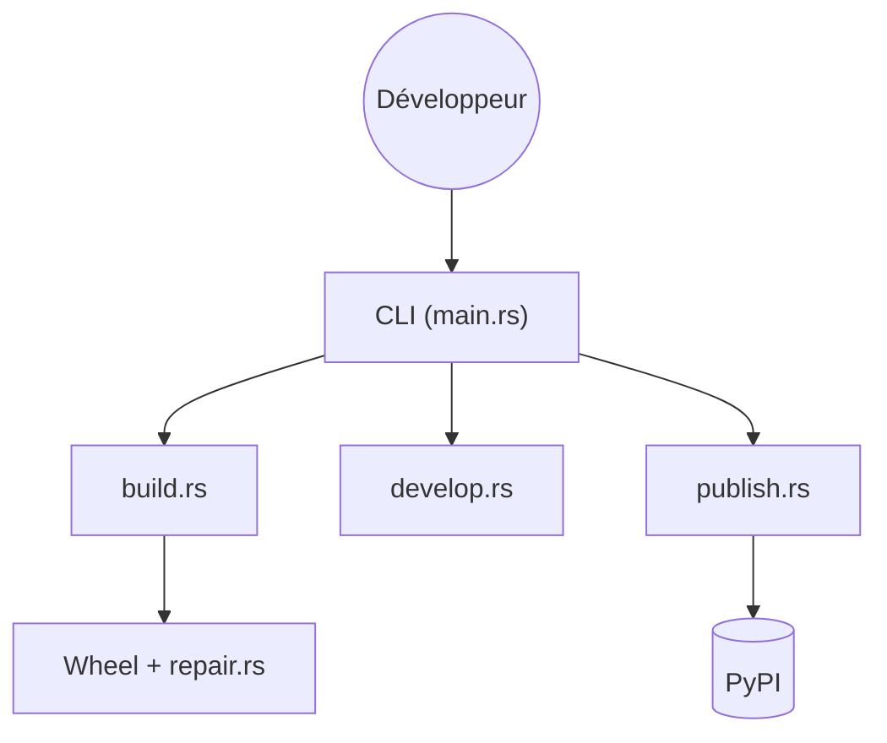

# PyO3/maturin

> Tool that compiles Rust crates into Python packages (wheels), for those who write native extensions.

## The problem
Packaging Rust for Python (wheels, manylinux, PyPI publishing) takes a lot of configuration.

## What it actually does
Builds and publishes crates with pyo3, cffi, uniffi bindings or Rust binaries as Python packages. Handles wheels, sdist, manylinux compatibility checks, development installation, CI and stub generation. Also serves as a PEP 517 backend.

## How it is wired


## Trying it
```bash
pipx install maturin
uv tool install maturin
maturin new
maturin develop
maturin build
```

## Cost and gotchas
Free. A Rust toolchain is required; for widely compatible Linux wheels, a manylinux image or zig. `maturin develop` does not handle everything that `pip install` after `build` handles.

## What it is not
Not a general-purpose package manager. Not a replacement for PyPI.

## Alternatives
setuptools-rust (maturin does not get in the way of an existing configuration).

## For you
Adopt: the README cites polars, pydantic-core, ruff, orjson, so it is the standard tool for speeding up critical Python code with Rust.
