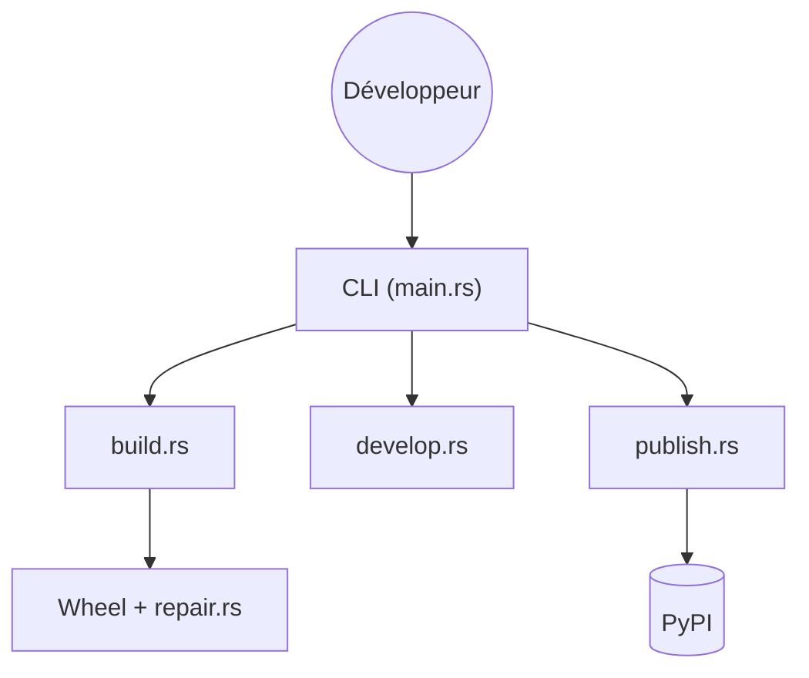

# PyO3/maturin

> Outil qui compile des crates Rust en paquets Python (wheels), pour qui écrit des extensions natives.

## Le problème
Empaqueter du Rust pour Python (wheels, manylinux, publication PyPI) demande beaucoup de configuration.

## Ce que ça fait vraiment
Construit et publie des crates avec liaisons pyo3, cffi, uniffi ou des binaires Rust comme paquets Python. Gère wheels, sdist, vérification de compatibilité manylinux, installation en développement, génération de CI et de stubs. Sert aussi de backend PEP 517.

## Comment c'est branché


## Essayer
```bash
pipx install maturin
uv tool install maturin
maturin new
maturin develop
maturin build
```

## Coût et pièges
Gratuit. Il faut une chaîne Rust ; pour des wheels Linux largement compatibles, une image manylinux ou zig. `maturin develop` ne gère pas tout ce que `pip install` après `build` gère.

## Ce que ce n'est pas
Pas un gestionnaire de paquets généraliste. Pas un remplaçant de PyPI.

## Alternatives
setuptools-rust (maturin ne gêne pas une configuration existante).

## Pour toi
Adopter : le README cite polars, pydantic-core, ruff, orjson, donc c'est l'outil standard pour accélérer du code Python critique en Rust.

