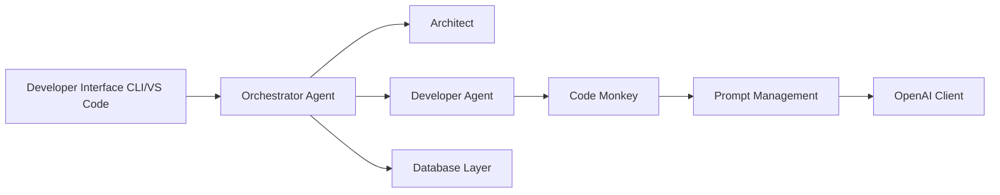

# Pythagora-io/gpt-pilot

> CLI tool of LLM agents that generate an application step by step, now unmaintained.

## The problem
Code generators produce everything in one go, which makes bugs hard to fix.

## What it actually does
Chain of agents (Spec Writer, Architect, Tech Lead, Developer, Code Monkey, Reviewer, Troubleshooter, Debugger, Technical Writer) orchestrated from `main.py`.
Calls OpenAI, Anthropic or Groq; stores state in SQLite (or PostgreSQL) and code in `workspace/`.
Only shows the LLM the code relevant to the current task.
Engine of the Pythagora VS Code extension.

## How it is wired


## Trying it
```bash
git clone https://github.com/Pythagora-io/gpt-pilot.git
cd gpt-pilot
python3 -m venv venv
source venv/bin/activate
pip install -r requirements.txt
cp example-config.json config.json
python main.py
```

## Cost and gotchas
**A credential-stealing worm (core/telemetry/) was present from August 2025 to June 11, 2026**: if you ran it from source, rotate all your secrets. LLM key at your expense.

## What it is not
No longer maintained ("This repo is not being maintained anymore"), hence the compromise went unnoticed. Not an autonomous generator: a developer must supervise.

## Alternatives
- Smol developer: cited as a competing approach, generates the codebase in one go.
- GPT engineer: same.

## For you
Stay away; useful only as a case study of a supply-chain attack.
