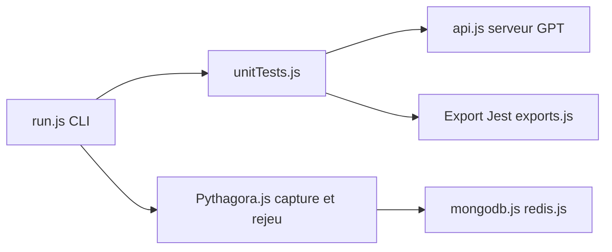

# Pythagora-io/pythagora

> Node tool that generates Jest unit tests with GPT-4, declared obsolete in favor of GPT Pilot.

## The problem
Writing unit tests for JavaScript functions is time-consuming and leaves edge cases uncovered.

## What it actually does
Finds the target function and its dependencies through AST analysis, sends everything to the Pythagora server, which generates the tests with GPT-4, exported as Jest. It can also extend an existing suite. The code additionally contains a mode that records and replays HTTP, MongoDB and Redis traffic for integration tests. The README opens with a warning: repository deprecated.

## How it is wired


## Trying it
```bash
npm i pythagora --save-dev
npx pythagora --config --openai-api-key <API_KEY>
npx pythagora --unit-tests --func <FUNCTION_NAME>
npx jest ./pythagora_tests/
```

## Cost and gotchas
OpenAI or Pythagora key at your expense. The code is sent to OpenAI, which the README acknowledges. Only Jest tests are produced. On Windows, use Git Bash.

## What it is not
Not maintained: the repository is deprecated. Generated tests need reviewing: in the README's example, 17 out of 145 fail and 6 were badly written. Announced as "alpha".

## Alternatives
GPT Pilot is cited as the project that replaces this repository.

## For you
Ignore: repository declared deprecated, dependent on GPT-4 and limited to Jest; use the replacement project instead if it interests you.
