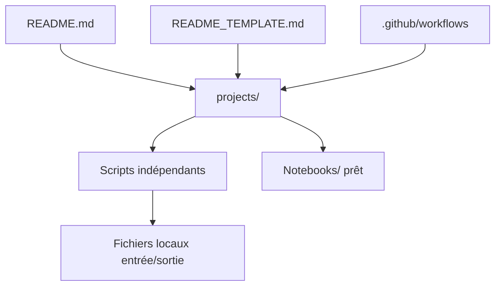

# Python-World/python-mini-projects

> Collection of small independent Python scripts, for beginners learning by contributing to open source.

## The problem
A beginner lacks concrete exercises and a first repository to push a contribution to.

## What it actually does
The README only describes the contribution procedure (fork, branch, folder README, pull request). From the architecture, `projects/` contains dozens of unrelated scripts: JSON/CSV converters, Flask todo, scraping, Telegram bot, mail sending, plus a loan repayment prediction notebook. Each folder has its own dependencies.

## How it is wired


## Trying it
```bash
git clone https://github.com/<your-github-username>/python-mini-projects.git
git checkout -b <branch-name>
git push origin <branch-name>
```

## Cost and gotchas
Free. Archived repository, last push in 2022. Some folders contain credential files (`credentials.txt`, `config.ini`): never put real secrets in them.

## What it is not
It is not a library nor a maintained project: quality varies from one script to another and nothing is guaranteed.

## Alternatives
The README cites no alternative.

## For you
Ignore: archived, of no value for an experienced profile; useful only as a source of exercise ideas.
