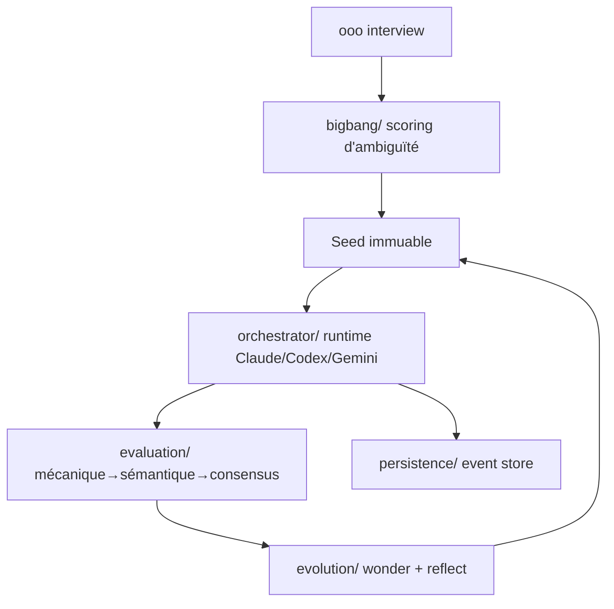

# Q00/ouroboros

> Specification layer that forces a coding agent to clarify intent before writing.

## The problem
A vague prompt turns into code: the agent guesses, the architecture drifts, and wrong assumptions only show up when the PR is reviewed.
Nothing keeps a record of what was decided from one session to the next.

## What it actually does
A Socratic interview questions the request and produces an ambiguity score; below 0.2, moving on to code is blocked without `force`.
The answers are frozen into an immutable "Seed" (acceptance criteria, ontology, constraints), then executed through Double Diamond decomposition.
A three-stage evaluation gate (mechanical, semantic, multi-model consensus) judges the result, and the "evolve" loop feeds the verdict back into the next generation.
An event log (SQLAlchemy + aiosqlite) replays the history, which lets `ooo ralph` resume after a machine restart.

## How it is wired


## Trying it
```bash
curl -fsSL https://raw.githubusercontent.com/Q00/ouroboros/main/scripts/install.sh | OUROBOROS_INSTALL_REF=readme bash
# puis, dans une session d'agent :
ooo setup
ooo interview "I want to build a task management CLI"
# ou depuis un terminal nu :
ouroboros init start --orchestrator "I want to build a task management CLI tool"
```

## Cost and gotchas
The package is free but every step calls a model: the bill stays that of your Claude/Codex subscription or your keys. Python ≥ 3.12 is required, and LiteLLM is limited to 3.12–3.13.
Native Windows is declared experimental and Codex CLI requires WSL 2 there; below 0.51.1 the MCP installation fails at startup.

## What it is not
It is not a coding agent: it produces nothing on its own, it drives the one you already have. It is not a speed gain — the interview adds a round before any writing.
The "1x/10x/30x" router optimizes cost, it does not remove it. Thirteen hosts are advertised but only those installed on your machine are wired up.

## Alternatives
- `Ouro-labs/ourocode`: the terminal shell of the same stack, if you want a unified TUI rather than the core.
- `Ouro-labs/ouroboros-plugins`: to package business workflows instead of the raw engine.
- `razzant/ouroboros`: unaffiliated project of the same name, a self-modifying agent — the opposite of the spec-first approach.

## For you
Worth a look if your agent prompts drift on long tasks; the addition of thirteen integrations sounds like a race for surface area.
