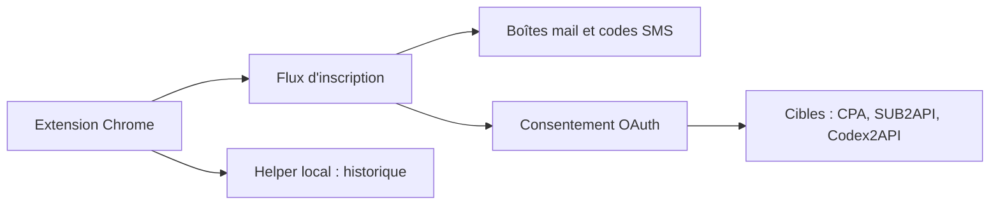

# QLHazyCoder/FlowPilot

> Chrome extension that automates bulk registration and authorization of ChatGPT/OpenAI, Kiro and Grok accounts.

## The problem
The README (in Chinese) does not state it; the tool is used to create accounts in volume and deliver them to third-party API gateways.

## What it actually does
A side panel that chains email registration, retrieval of verification codes (many mail services, SMS), OAuth consent and delivery of the accounts to CPA, SUB2API, Codex2API, webchat, ChatGPT2API; separate flows for Kiro and Grok. Automatic retries, a history panel, proxies. The README contains an ad for a residential proxy provider with a promo code.

## How it is wired


## Trying it
```bash
# Aucune commande : chrome://extensions → mode développeur
# → « Charger l'extension non empaquetée » → choisir le dossier du projet
```

## Cost and gotchas
Proxies, mailboxes and phone numbers are at your expense. Automated bulk registration very likely violates the terms of the targeted platforms (to be verified): risk of being banned.

## What it is not
Not a neutral productivity tool nor a data tool: it creates accounts in series. No architecture documentation in English.

## Alternatives
No alternative named in the README.

## For you
Ignore: a platform-circumvention use, worthless for a data/AI profile and with a real compliance risk.
